# Cobalt Ridge Financial: Active Directory Fundamentals Lab (Entry Level, VMware Workstation)

A beginner-friendly, scenario-based Active Directory lab for a fictional small bank, **Cobalt Ridge Financial**. I built it on **VMware Workstation** with just two virtual machines: a Windows Server **domain controller** and a Windows 11 **employee computer**. No cloud subscription is needed.

The goal is simple: take a company that has no central user management, and set up the everyday things a junior IT administrator is trusted with. That means organizing people, giving them the right access to shared folders, setting basic security rules, and handling new hires, role changes and leavers.

> **Fictional environment:** every company and person in this lab is made up. Never practise these steps on a real company's domain.

**What I was asked to do (my manager's four requests):**

| # | Request from my IT manager | What it means in plain English | Done in |
| - | -------------------------- | ------------------------------ | ------- |
| 1 | "Give every employee one sign-in that works on every company PC" | Build a domain, create users, join a PC to it | Sections 2, 4, 6 |
| 2 | "Make sure people only open the folders for their own department" | Shared folders with permissions based on groups | Sections 4, 5 |
| 3 | "Set basic security rules for passwords and one restriction for HR PCs" | Group Policy | Section 7 |
| 4 | "Handle new hires, transfers and leavers the same way every time" | The account lifecycle (Joiner, Mover, Leaver) | Section 8 |

**Skills practised:** Windows Server, Active Directory Domain Services (AD DS), DNS basics, Organizational Units, users and security groups, NTFS and share permissions, Group Policy, PowerShell basics, Event Viewer.

---

## Architecture

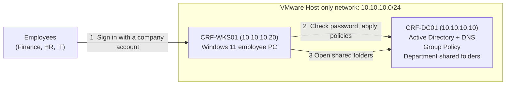

*Two VMs on a private VMware network. The Windows 11 PC asks the domain controller to check every sign-in, applies the company's Group Policies, and opens department folders that the domain controller shares.*

### How folder access works (the one idea to remember)

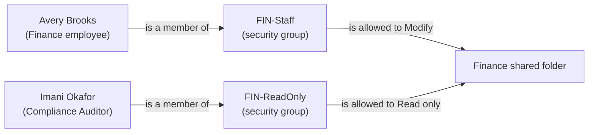

*I never give a person access to a folder directly. I put people in groups and give the group access. When someone changes jobs, I change their groups and the access follows.*

---

## What I Did

### 1. Built the Lab in VMware Workstation

**Scenario:** Before I could touch Active Directory, I needed somewhere safe to practise. I used two virtual machines on a private network, so nothing I did could affect my real computer or any real company.

**Lab machines:**

| VM name | Role | OS | CPU / RAM / Disk | IP address |
| ------- | ---- | -- | ---------------- | ---------- |
| `CRF-DC01` | Domain controller (holds all the accounts) | Windows Server evaluation | 2 / 4 GB / 60 GB | 10.10.10.10 |
| `CRF-WKS01` | Employee computer | Windows 11 Enterprise evaluation | 2 / 4 GB / 64 GB | 10.10.10.20 |

**Steps:**

1. Downloaded the Windows Server and Windows 11 Enterprise **evaluation ISOs** from the Microsoft Evaluation Center. Evaluation versions are free and time-limited, which is fine for a lab.

2. Created the first VM in VMware Workstation with **File → New Virtual Machine → Custom**, chose the Windows Server ISO, and gave it the name `CRF-DC01` and the sizes in the table.

3. Set its network adapter to **Host-only** (in **VM → Settings → Network Adapter**). Host-only means the VMs can talk to each other but not to the internet, so the lab is safely separated from everything else.

4. Installed Windows Server, choosing the **Standard Evaluation (Desktop Experience)** edition so I get the normal graphical desktop, then installed **VMware Tools** inside it.

5. Created the second VM, `CRF-WKS01`, the same way using the Windows 11 ISO, also on **Host-only**. Windows 11 needs a virtual security chip (TPM), so before installing I changed these settings:

   - **VM → Settings → Options → Advanced:** set firmware type to **UEFI** and tick **Secure Boot**
   - **VM → Settings → Options → Access Control:** click **Encrypt** and set a password (VMware requires this before it allows a virtual TPM)
   - **VM → Settings → Hardware → Add → Trusted Platform Module**

6. During Windows 11 setup, I created a **local account** (I named it `localadmin`). If setup offers *Domain join instead* under the sign-in options, that works too. I joined the domain later in Section 6.

7. Took a VMware **snapshot** of each VM named `01-fresh-install`. A snapshot is a save point: if I break something, I can go back in a minute.

> **Tip:** Take a snapshot at the end of every section. It is the best safety net in any lab.

| 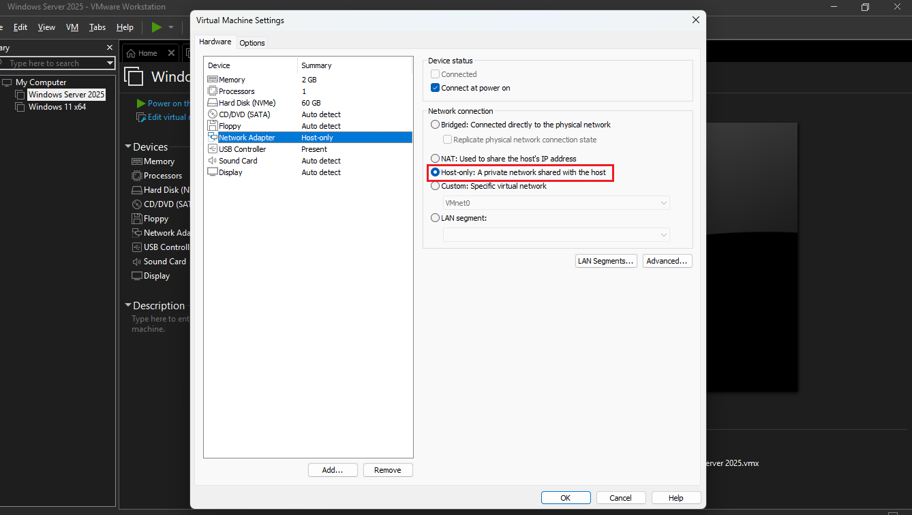 | 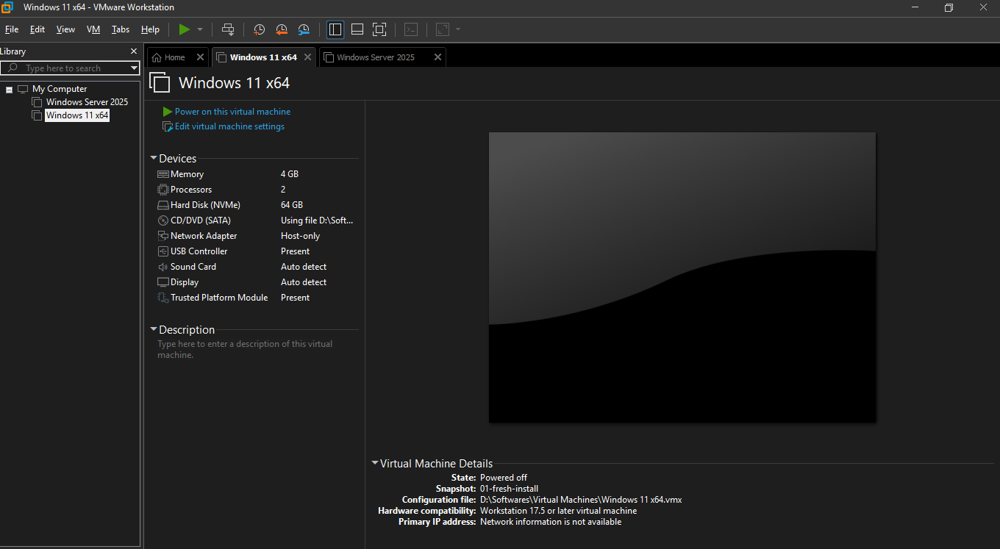 |
| ------------------------------------ | ---------------------------- |
| *Screenshot: The network adapter settings of CRF-DC01 set to Host-only.* | *Screenshot: Both VMs listed in VMware Workstation.* |

---

### 2. Set Up the Domain Controller

**Scenario:** Right now every PC at Cobalt Ridge has its own separate accounts. A **domain controller** fixes that by keeping one central list of users, passwords and computers. To build one, I install the **Active Directory Domain Services** role on a Windows Server and "promote" it.

**New words:**

- **Domain:** the company's private network of accounts and computers. Mine is called `cobaltridge.lab`.
- **Domain controller (DC):** the server that stores the accounts and checks every sign-in.
- **DNS:** the service that turns names into addresses. Active Directory will not work without it, and the DC runs it for me.

**Steps:**

1. Signed in to `CRF-DC01` and **renamed** the computer to `CRF-DC01` (**Server Manager → Local Server → Computer name → Change**), then restarted.

2. Gave the server a **fixed (static) IP address**. A domain controller must never change address. I pressed **Win + R**, typed `ncpa.cpl`, right-clicked the network adapter, chose **Properties → Internet Protocol Version 4 → Properties**, and entered:

   | Setting | Value |
   | ------- | ----- |
   | IP address | `10.10.10.10` |
   | Subnet mask | `255.255.255.0` |
   | Default gateway | *(left empty)* |
   | Preferred DNS server | `10.10.10.10` (the server itself) |

3. Installed the AD DS role: **Server Manager → Manage → Add Roles and Features**, clicked **Next** until **Server Roles**, ticked **Active Directory Domain Services**, accepted the extra features, and clicked **Install**.

4. When the install finished, clicked the yellow flag at the top of Server Manager and chose **Promote this server to a domain controller**:

   - Chose **Add a new forest**
   - Set the **Root domain name** to `cobaltridge.lab`
   - Entered a **Directory Services Restore Mode (DSRM) password**. This is a special emergency password for repairing the server. I saved it in my password manager and nowhere else.
   - Clicked **Next** through the remaining pages (a warning about a *DNS delegation* is normal in a lab and safe to ignore)
   - Clicked **Install**. The server restarted by itself.

5. After the restart, the sign-in screen showed `COBALTRIDGE\Administrator`. I signed in and **checked that the domain existed**:

   - Opened **Server Manager → Tools → Active Directory Users and Computers** and saw `cobaltridge.lab`
   - Ran this in PowerShell (as Administrator):

   ```powershell
   Get-ADDomain | Select-Object Name, DNSRoot, NetBIOSName
   ```

6. Took a snapshot named `02-dc-ready`.

| 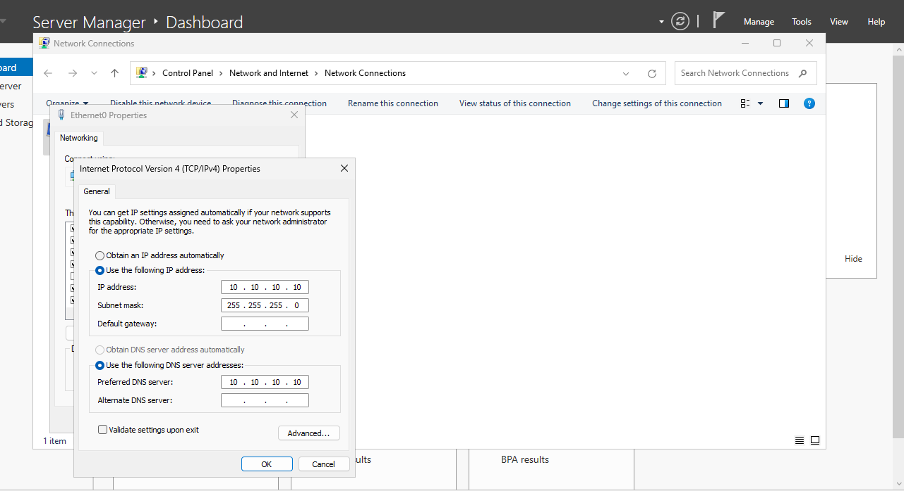 | 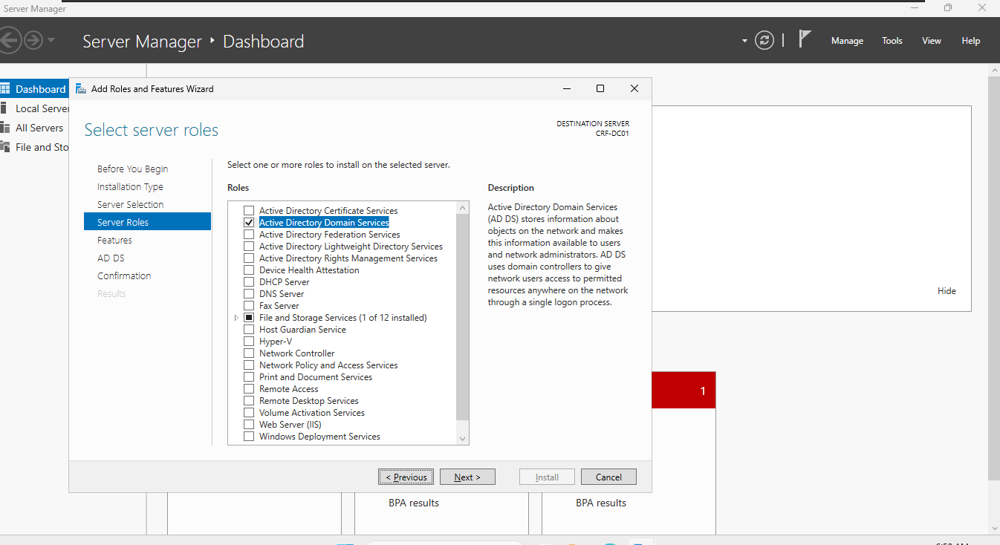 |
| ---------------------------- | ------------------------------ |
| *Screenshot: The IPv4 settings of CRF-DC01 with the static address and DNS pointing at itself.* | *Screenshot: The Add Roles and Features wizard with Active Directory Domain Services ticked.* |
| 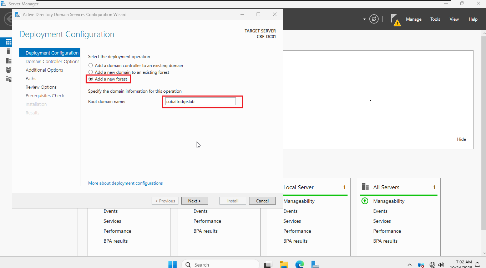 | 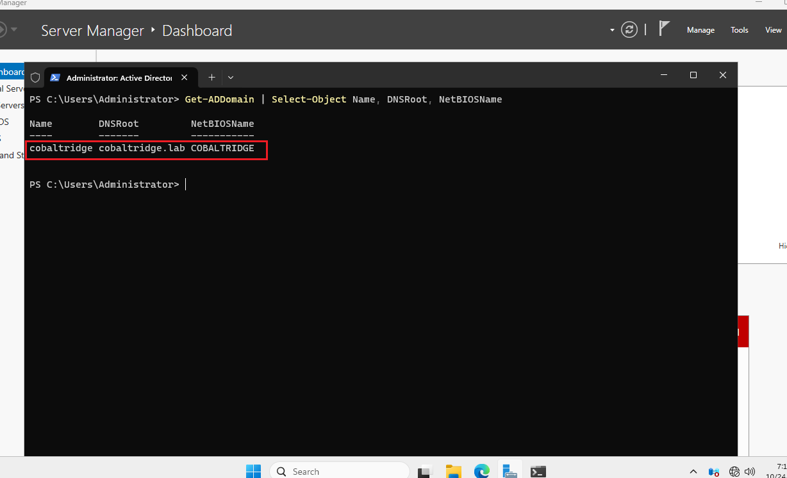 |
| *Screenshot: The "Add a new forest" page with cobaltridge.lab entered.* | *Screenshot: The `Get-ADDomain` output.* |

---

### 3. Organized the Company with Organizational Units (OUs)

**Scenario:** An empty domain is like an empty filing cabinet. Before adding people, I created folders for them. In Active Directory these folders are called **Organizational Units (OUs)**. They matter because I can apply a rule (a Group Policy) to one OU without touching the others.

**Target structure:**

```
cobaltridge.lab
└── CobaltRidge
    ├── Finance          (Finance department users)
    ├── HR               (HR department users)
    ├── IT               (IT department users)
    ├── Computers        (company PCs)
    ├── Groups           (security groups)
    └── Disabled-Users   (accounts of people who left)
```

**Steps:**

1. Opened **Active Directory Users and Computers**.

2. Right-clicked `cobaltridge.lab` → **New → Organizational Unit**, named it `CobaltRidge`, and kept **Protect container from accidental deletion** ticked.

3. Right-clicked the new `CobaltRidge` OU and created six OUs inside it the same way: `Finance`, `HR`, `IT`, `Computers`, `Groups` and `Disabled-Users`.

4. **Shortcut:** to rebuild this quickly next time, the same structure can be created with a script (it is optional, the point is to learn the clicks first).

   <details>
   <summary><strong>scripts/01-Create-OUs.ps1</strong> (click to expand)</summary>

   ```powershell
   <#
     01-Create-OUs.ps1
     Run on : CRF-DC01 (PowerShell as Administrator)
     Purpose: Optional shortcut for Section 3. Builds the CobaltRidge OU structure.
              (You can also create these by hand in Active Directory Users and Computers.)
   #>
   Import-Module ActiveDirectory

   $dn = (Get-ADDomain).DistinguishedName
   New-ADOrganizationalUnit -Name "CobaltRidge" -Path $dn

   $root = "OU=CobaltRidge,$dn"
   "Finance","HR","IT","Computers","Groups","Disabled-Users" |
       ForEach-Object { New-ADOrganizationalUnit -Name $_ -Path $root }

   # Check the result
   Get-ADOrganizationalUnit -Filter * -SearchBase $root | Select-Object Name, DistinguishedName
   ```

   </details>

5. Took a snapshot named `03-ous-created`.

| 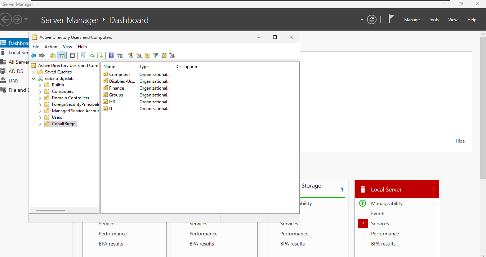 |
| ---------------------------- |
| *Screenshot: Active Directory Users and Computers showing the CobaltRidge OU and the six OUs inside it.* |

---

### 4. Created Users and Security Groups

**Scenario:** Now for the people. Cobalt Ridge has three departments, so I created employees in each one. I also created **security groups**, which are lists of users that I can give access to things. The rule I follow throughout this lab: **give access to groups, not to individual people.**

**The people:**

| Name | Username | Department (OU) | Job title | Group(s) |
| ---- | -------- | --------------- | --------- | -------- |
| Avery Brooks | `abrooks` | Finance | Financial Analyst | `FIN-Staff` |
| Nolan Pierce | `npierce` | Finance | Accounts Payable Lead | `FIN-Staff` |
| Marcus Ellery | `mellery` | HR | HR Manager | `HR-Staff` |
| Talia Whitmore | `twhitmore` | HR | HR Generalist | `HR-Staff` |
| Elias Brandt | `ebrandt` | IT | Help Desk Technician | `IT-Staff` |
| Imani Okafor | `iokafor` | IT | Compliance Auditor | `IT-Staff`, `FIN-ReadOnly` |

**Steps:**

1. **Created my first user by hand** to learn the screens. In the `Finance` OU, right-clicked → **New → User** and filled in Avery Brooks:

   - First name `Avery`, Last name `Brooks`, User logon name `abrooks`
   - Typed a **temporary password of at least 12 characters** (a password I will not reuse anywhere)
   - Ticked **User must change password at next logon**, which makes the employee choose their own password at first sign-in

2. **Created the four security groups** in the `Groups` OU: right-click → **New → Group**, scope **Global**, type **Security**. Names: `FIN-Staff`, `HR-Staff`, `IT-Staff`, `FIN-ReadOnly`.

3. **Added Avery to a group:** double-clicked `FIN-Staff` → **Members** tab → **Add** → typed `abrooks` → **Check Names** → **OK**.

4. **Created the rest with a script.** Clicking through five more users is slow, so I used PowerShell. The script asks me for the temporary password when it runs, so **no password is ever saved in the file**, and it skips Avery because the account already exists.

   <details>
   <summary><strong>scripts/02-Create-Users-and-Groups.ps1</strong> (click to expand)</summary>

   ```powershell
   <#
     02-Create-Users-and-Groups.ps1
     Run on : CRF-DC01 (PowerShell as Administrator)
     Purpose: Create the four security groups and the six starting employees.
              Safe to re-run: it skips anything that already exists, so it is fine
              if you already created one user by hand.
     NOTE   : The temporary password is typed at a prompt. It is never stored in this file.
   #>
   Import-Module ActiveDirectory

   $domain = Get-ADDomain
   $root   = "OU=CobaltRidge,$($domain.DistinguishedName)"

   $tempPassword = Read-Host -Prompt "Temporary password for new users (12+ characters)" -AsSecureString

   # ---- Groups -----------------------------------------------------------------
   "FIN-Staff","HR-Staff","IT-Staff","FIN-ReadOnly" | ForEach-Object {
       if (-not (Get-ADGroup -Filter "Name -eq '$_'")) {
           New-ADGroup -Name $_ -GroupScope Global -GroupCategory Security -Path "OU=Groups,$root"
       }
   }

   # Which group each department's staff belong to
   $groupFor = @{ Finance = "FIN-Staff"; HR = "HR-Staff"; IT = "IT-Staff" }

   # ---- Users ------------------------------------------------------------------
   $users = @(
       @{ First = "Avery";  Last = "Brooks";    Sam = "abrooks";    Dept = "Finance"; Title = "Financial Analyst" }
       @{ First = "Nolan";  Last = "Pierce";    Sam = "npierce";    Dept = "Finance"; Title = "Accounts Payable Lead" }
       @{ First = "Marcus"; Last = "Ellery";    Sam = "mellery";    Dept = "HR";      Title = "HR Manager" }
       @{ First = "Talia";  Last = "Whitmore";  Sam = "twhitmore";  Dept = "HR";      Title = "HR Generalist" }
       @{ First = "Elias";  Last = "Brandt";    Sam = "ebrandt";    Dept = "IT";      Title = "Help Desk Technician" }
       @{ First = "Imani";  Last = "Okafor";    Sam = "iokafor";    Dept = "IT";      Title = "Compliance Auditor" }
   )

   foreach ($u in $users) {
       if (-not (Get-ADUser -Filter "SamAccountName -eq '$($u.Sam)'")) {
           $params = @{
               Name                  = "$($u.First) $($u.Last)"
               GivenName             = $u.First
               Surname               = $u.Last
               SamAccountName        = $u.Sam
               UserPrincipalName     = "$($u.Sam)@$($domain.DNSRoot)"
               Title                 = $u.Title
               Department            = $u.Dept
               Path                  = "OU=$($u.Dept),$root"
               AccountPassword       = $tempPassword
               ChangePasswordAtLogon = $true
               Enabled               = $true
           }
           New-ADUser @params
       }
       Add-ADGroupMember -Identity $groupFor[$u.Dept] -Members $u.Sam -ErrorAction SilentlyContinue
   }

   # The auditor also gets read-only access to the Finance share (set up in Section 5)
   Add-ADGroupMember -Identity "FIN-ReadOnly" -Members "iokafor" -ErrorAction SilentlyContinue

   # ---- Check ------------------------------------------------------------------
   Get-ADUser -Filter * -SearchBase $root -Properties Department, Title |
       Select-Object SamAccountName, Department, Title | Sort-Object Department, SamAccountName
   ```

   </details>

5. **Checked the result** in Active Directory Users and Computers: each user sat in the right department OU, and each group showed the right members (double-click a group → **Members**).

6. Took a snapshot named `04-users-and-groups`.

> **Never put a real password in a screenshot or a script.** If you need to show a command that asks for a password, show the prompt, not the answer.

| 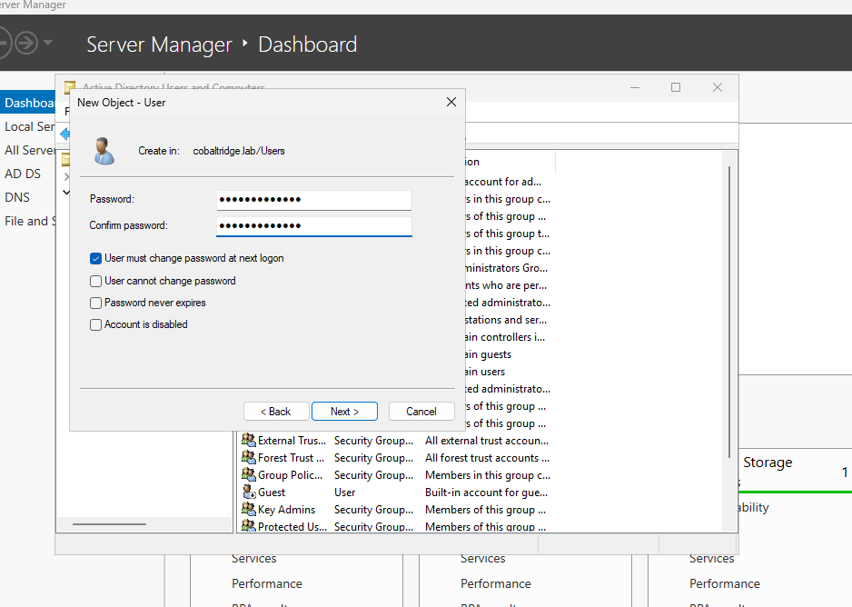 | 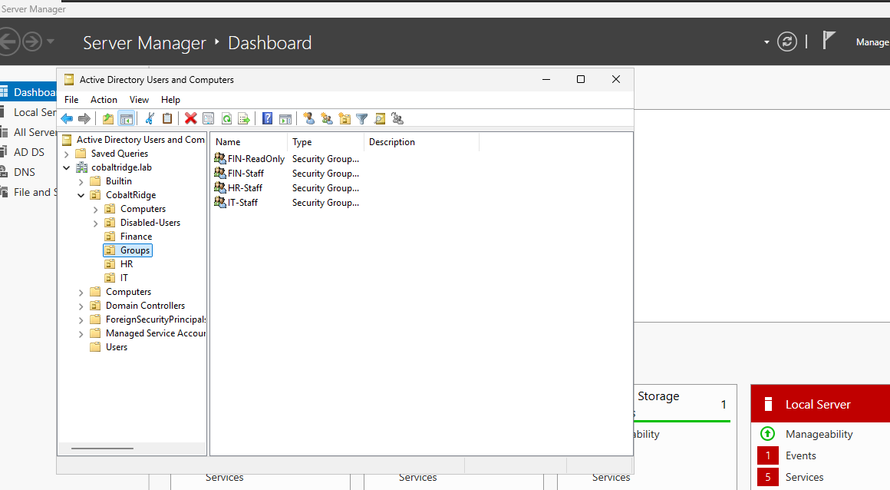 |
| ------------------------------- | ---------------------------------------- |
| *Screenshot: The New Object - User wizard with "User must change password at next logon" ticked (password hidden).* | *Screenshot: The department OUs with their users, and the Groups OU with the four security groups.* |

---

### 5. Created Shared Folders and Controlled Who Can Open Them

**Scenario:** The Finance team's spreadsheets must not be readable by everyone, and HR files are even more private. I created one shared folder per department and gave access only to the matching group. The company's auditor, Imani, also needs to **read** Finance files but must never change them.

> **Lab shortcut:** I put the shares on the domain controller to keep the lab to two VMs. A real company would use a separate file server, because a domain controller should do only one job. The **Advanced** version of this lab does that.

**New words:**

- **Share permissions:** control who can reach a folder across the network.
- **NTFS permissions:** control what someone can do inside the folder (read, change, delete). When the two disagree, the **stricter one wins**.

**Steps:**

1. On `CRF-DC01`, created the folders `C:\Shares\Finance` and `C:\Shares\HR` in File Explorer.

2. **Shared the Finance folder:** right-click → **Properties → Sharing → Advanced Sharing**, ticked **Share this folder**, clicked **Permissions**, removed **Everyone**, added **Authenticated Users** and ticked **Change**. Then did the same for the HR folder. I kept the share permission broad on purpose, because the NTFS permissions in the next step do the real restricting.

3. **Set the folder (NTFS) permissions for Finance:** **Properties → Security → Advanced**, clicked **Disable inheritance → Convert inherited permissions into explicit permissions**, then removed the entries for **Users**. Using **Edit → Add**, gave:

   | Group | Permission on Finance |
   | ----- | --------------------- |
   | `FIN-Staff` | **Modify** |
   | `FIN-ReadOnly` | **Read & execute** |
   | Administrators and SYSTEM | Full control (left as they were) |

4. **Did the same for HR:** only `HR-Staff` gets **Modify**, and nobody else gets anything.

5. **Shortcut:** the same result can be reached with a script (optional).

   <details>
   <summary><strong>scripts/03-Create-Shares.ps1</strong> (click to expand)</summary>

   ```powershell
   <#
     03-Create-Shares.ps1
     Run on : CRF-DC01 (PowerShell as Administrator), AFTER the groups exist
     Purpose: Optional shortcut for Section 5. Creates C:\Shares\Finance and C:\Shares\HR,
              sets folder (NTFS) permissions using groups, and shares both folders.
     NOTE   : Hosting shares on a domain controller is a lab shortcut. A real company
              would use a separate file server.
   #>
   $root = "C:\Shares"

   $shares = @{
       "Finance" = @{ Modify = "FIN-Staff"; Read = "FIN-ReadOnly" }
       "HR"      = @{ Modify = "HR-Staff";  Read = $null }
   }

   foreach ($name in $shares.Keys) {
       $path = Join-Path $root $name
       New-Item -ItemType Directory -Path $path -Force | Out-Null

       # Folder (NTFS) permissions: remove inheritance, then grant ONLY the groups we want
       $icaclsArgs = @($path, "/inheritance:r", "/grant",
           "BUILTIN\Administrators:(OI)(CI)F",
           "NT AUTHORITY\SYSTEM:(OI)(CI)F",
           "COBALTRIDGE\$($shares[$name].Modify):(OI)(CI)M")
       if ($shares[$name].Read) { $icaclsArgs += "COBALTRIDGE\$($shares[$name].Read):(OI)(CI)RX" }
       icacls @icaclsArgs | Out-Null

       # Share the folder (the NTFS permissions above do the real restricting)
       New-SmbShare -Name $name -Path $path -ChangeAccess "NT AUTHORITY\Authenticated Users" -FullAccess "BUILTIN\Administrators" | Out-Null
   }

   Get-SmbShare | Where-Object Name -in "Finance","HR" | Select-Object Name, Path
   ```

   </details>

6. Took a snapshot named `05-shares-ready`. I tested the permissions in Section 6, once a real employee PC was on the domain.

| 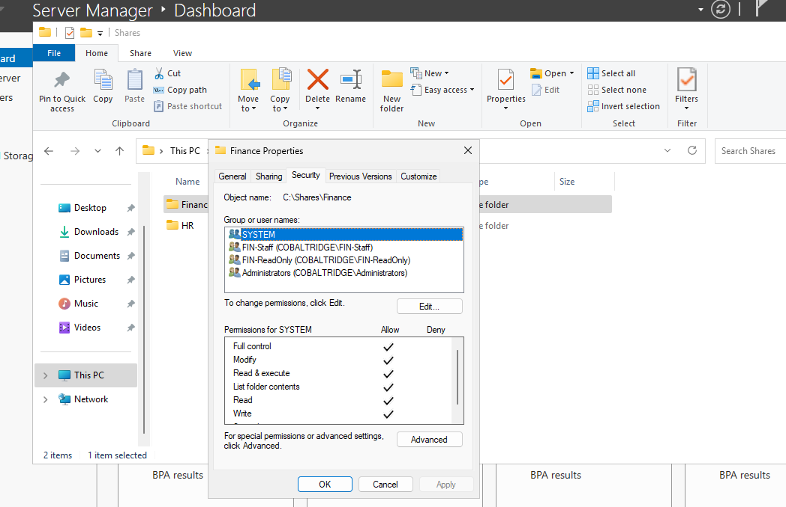 |
| ---------------------------------------------- |
| *Screenshot: The Security tab of the Finance folder showing only FIN-Staff (Modify) and FIN-ReadOnly (Read & execute), plus Administrators and SYSTEM.* |

---

### 6. Joined the Windows 11 PC to the Domain and Tested Access

**Scenario:** This is the "domain joined endpoint" step: turning an ordinary PC into a company PC. After this, an employee can sit at CRF-WKS01 and sign in with the account I created, from any PC that has joined the domain.

**Steps:**

1. On `CRF-WKS01`, signed in as `localadmin` and gave the PC a fixed address the same way as in Section 2:

   | Setting | Value |
   | ------- | ----- |
   | IP address | `10.10.10.20` |
   | Subnet mask | `255.255.255.0` |
   | Preferred DNS server | `10.10.10.10` (the **domain controller**, not the PC itself) |

   > **The golden rule of domain joins:** a PC joining the domain must use the domain controller as its DNS server. If the join fails, check this first.

2. Confirmed the PC can see the domain controller. In PowerShell:

   ```powershell
   Resolve-DnsName cobaltridge.lab        # should return 10.10.10.10
   ```

3. **Joined the domain:** **Settings → System → About → Domain or workgroup → Change...**, chose **Domain**, typed `cobaltridge.lab`, and signed in with `COBALTRIDGE\Administrator` when asked. I saw **"Welcome to the cobaltridge.lab domain"** and restarted.

4. Back on `CRF-DC01`, opened **Active Directory Users and Computers**, found `CRF-WKS01` in the default **Computers** container, and dragged it into my `CobaltRidge → Computers` OU so it is organized with the rest of the company.

5. **Signed in as a company employee:** on the sign-in screen chose **Other user** and entered `COBALTRIDGE\abrooks` with the temporary password. Windows made me **choose a new password**, which is exactly what the "must change password at next logon" box does.

6. **Tested the shared folders.** For each person, I signed in on `CRF-WKS01`, typed `\\CRF-DC01\Finance` and then `\\CRF-DC01\HR` into the File Explorer address bar, and tried to create a new folder:

   | Signed in as | Finance share | HR share |
   | ------------ | ------------- | -------- |
   | `abrooks` (Finance) | Can open and create files | Access denied |
   | `mellery` (HR) | Access denied | Can open and create files |
   | `iokafor` (Auditor) | Can open and read, **cannot create** | Access denied |
   | `ebrandt` (IT) | Access denied | Access denied |

   The results matched the table. For the auditor, **New folder** failed with *"Destination Folder Access Denied"*, which proves the read-only access works.

7. Took a snapshot named `06-domain-joined` on both VMs.

> **Gotcha:** if a user's group changes while they are signed in, the change does not appear until they **sign out and sign back in**. I wasted time on this once, so I always sign out first.

| 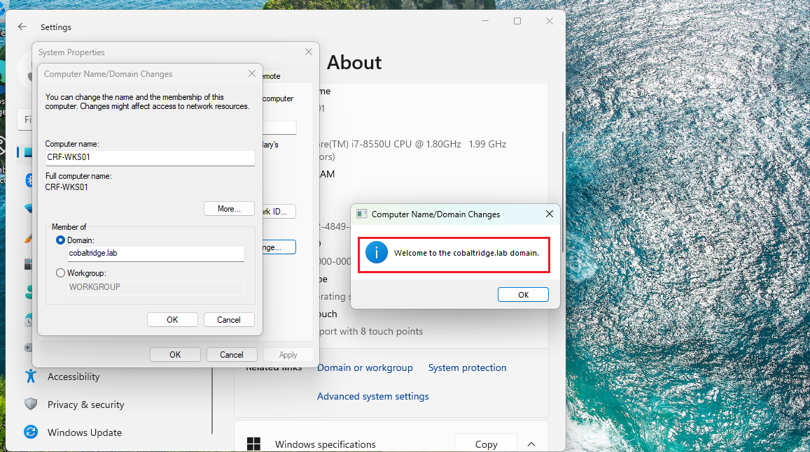 | 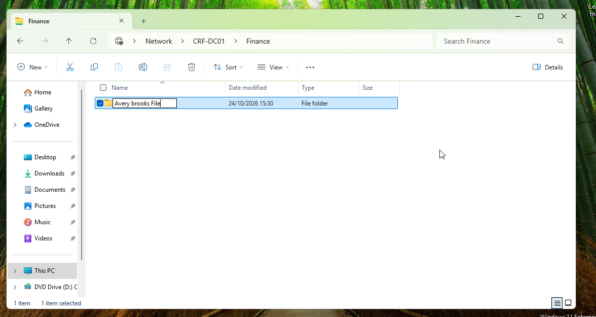 |
| ----------------------------------- | -------------------------------------- |
| *Screenshot: The "Welcome to the cobaltridge.lab domain" message.* | *Screenshot: Avery Brooks creating a file in the Finance share.* |
| 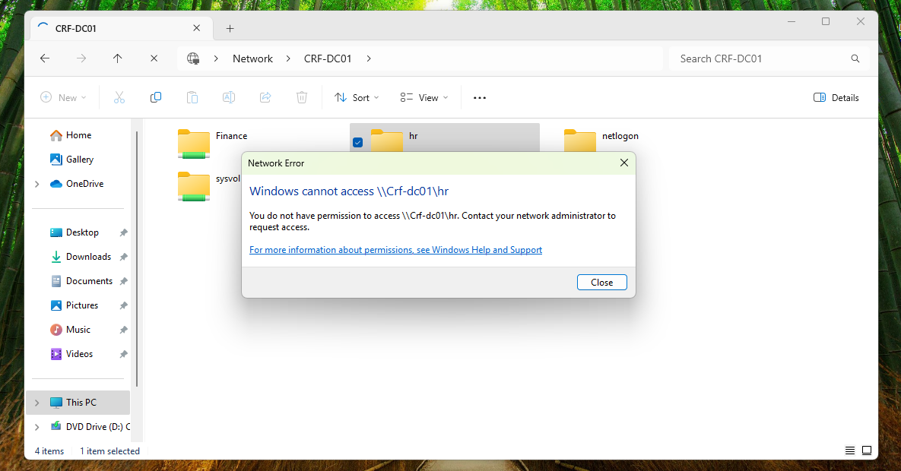 | |
| *Screenshot: Avery Brooks getting "Access denied" when opening the HR share.* | |

---

### 7. Set Basic Security Rules with Group Policy

**Scenario:** My manager had two asks. First, a company-wide rule: stronger passwords, and a temporary lock after too many wrong guesses. Second, HR laptops should not have the Command Prompt available. **Group Policy** lets me set a rule once on the server and have every PC follow it.

**Part A: Password and lockout policy for the whole company**

1. On `CRF-DC01`, opened **Server Manager → Tools → Group Policy Management**.

2. Went to **Forest → Domains → cobaltridge.lab**, right-clicked **Default Domain Policy** → **Edit**.

3. Navigated to **Computer Configuration → Policies → Windows Settings → Security Settings → Account Policies** and set:

   | Policy | Value | Why |
   | ------ | ----- | --- |
   | Enforce password history | 10 passwords | Stops people reusing the same few passwords |
   | Maximum password age | 90 days | Passwords get refreshed regularly |
   | Minimum password age | 1 day | Stops quick changes back to an old password |
   | Minimum password length | 12 characters | Longer passwords are harder to guess |
   | Password must meet complexity requirements | Enabled | Blocks very simple passwords |
   | Account lockout threshold | 5 invalid attempts | Allows typos, stops guessing |
   | Account lockout duration | 30 minutes | The account unlocks itself, so the IT team is not flooded with calls |
   | Reset account lockout counter after | 30 minutes | Matches the duration |

   When I set the lockout threshold, Windows showed a **Suggested Value Changes** box. I clicked **OK** and then checked that the duration and reset values were both 30 minutes.

4. Applied the policy: ran `gpupdate /force` in PowerShell on the DC.

**Part B: Block the Command Prompt for HR only**

1. In **Group Policy Management**, right-clicked the **HR** OU → **Create a GPO in this domain, and Link it here...** and named it `HR - Disable Command Prompt`.

2. Right-clicked that new GPO (under the HR OU) → **Edit**, and went to **User Configuration → Policies → Administrative Templates → System**.

3. Opened **Prevent access to the command prompt**, chose **Enabled**, set *Disable the command prompt script processing also?* to **Yes**, and clicked **OK**.

   > This works because the policy is linked to the **HR OU**. Only users inside that OU get the rule, so Finance and IT are untouched.

**Testing the policies** (on `CRF-WKS01`, after running `gpupdate /force` and signing out and in):

| Test | What I did | Result I expected and saw |
| ---- | ---------- | ------------------------- |
| Weak password rejected | As `abrooks`, pressed **Ctrl + Alt + Del → Change a password** and tried a short, simple password | Windows refused: it does not meet the length, complexity or history requirements |
| Account lockout | At the sign-in screen, typed a wrong password for `ebrandt` 5 times | "The referenced account is currently locked out and may not be logged on to" |
| Lockout recovery | On the DC, opened ebrandt's properties → **Account** tab → ticked **Unlock account** | Elias could sign in again |
| HR restriction | As `mellery` (HR), opened Command Prompt | "The command prompt has been disabled by your administrator" |
| Others unaffected | As `abrooks` (Finance), opened Command Prompt | It opened normally |

> **An honest note:** blocking Command Prompt is a **guard rail, not a locked door**. A determined user may find other tools. It teaches how policies are targeted at an OU, but real security restrictions are stronger than this.

Took a snapshot named `07-policies-applied` on both VMs.

|  |  |
| -------------------------------------- | -------------------------------------- |
| *Screenshot: The Password Policy and Account Lockout Policy settings in the Default Domain Policy.* | *Screenshot: Windows rejecting a weak password.* |
|  |  |
| *Screenshot: The sign-in screen saying the account is locked out.* | *Screenshot: The "Prevent access to the command prompt" setting set to Enabled in the HR GPO.* |
|  | |
| *Screenshot: "The command prompt has been disabled by your administrator" for the HR user.* | |

---

### 8. Handled the Account Lifecycle: Joiner, Mover, Leaver

**Scenario:** The last request was the one that matters most for security. Accounts are not created once and forgotten: people join, change jobs and leave, and each of those needs a clear routine. I handled one of each:

| Event at Cobalt Ridge | Stage | What it needs |
| --------------------- | ----- | ------------- |
| Jordan Maddox starts as a Junior Accountant in Finance | **Joiner** | Create the account, put it in the right OU, add it to the right group |
| Nolan Pierce moves from Finance to IT as a Systems Analyst | **Mover** | Take away the old access, then give the new access |
| Talia Whitmore (HR) resigns | **Leaver** | Disable the account, remove her access, move it out of the way |

**Joiner: the new hire**

1. In ADUC, created Jordan Maddox (`jmaddox`) in the **Finance** OU with a temporary password and **User must change password at next logon** ticked.
2. Added `jmaddox` to the `FIN-Staff` group.
3. Signed in as `jmaddox` on `CRF-WKS01`, was asked to set a new password, and confirmed the **Finance** share opened.

**Mover: the role change**

1. **Removed the old access first:** opened `FIN-Staff` → **Members** → removed `npierce`.
2. **Then added the new access:** added `npierce` to `IT-Staff`.
3. **Moved the account:** dragged Nolan Pierce from the `Finance` OU to the `IT` OU, and updated his **Title** to *Systems Analyst* and **Department** to *IT* on the **Organization** tab.
4. Signed in as `npierce` again and confirmed he could **no longer open the Finance share**.

> **Why remove first, then add?** If I added the new group first, Nolan would briefly have both roles. Removing first means he briefly has less access, which is safe. This order is a habit worth building from day one.

**Leaver: the resignation**

1. Right-clicked `twhitmore` → **Disable Account**. This blocks sign-in immediately.
2. Opened her **Member Of** tab and removed her from `HR-Staff`.
3. Added a note on the **General** tab, in *Description*: `Disabled <date> - resigned`.
4. Dragged the account into the **Disabled-Users** OU, so it is easy to find and clearly separate from active staff.
5. Tried to sign in as `twhitmore` on `CRF-WKS01` and got **"Your account has been disabled."**

**PowerShell version:** every step above can also be done with commands, which is faster once the clicks make sense. Run them one block at a time.

<details>
<summary><strong>scripts/04-Lifecycle-Examples.ps1</strong> (click to expand)</summary>

```powershell
<#
  04-Lifecycle-Examples.ps1
  Run on : CRF-DC01 (PowerShell as Administrator)
  Purpose: PowerShell versions of the Joiner / Mover / Leaver steps from Section 8.
           Run ONE block at a time (do not run the whole file at once).
#>
Import-Module ActiveDirectory
$domain = Get-ADDomain
$root   = "OU=CobaltRidge,$($domain.DistinguishedName)"

# ===== JOINER: new hire Jordan Maddox, Finance ==================================
$tempPassword = Read-Host -Prompt "Temporary password (12+ characters)" -AsSecureString
New-ADUser -Name "Jordan Maddox" -GivenName "Jordan" -Surname "Maddox" -SamAccountName "jmaddox" -UserPrincipalName "jmaddox@$($domain.DNSRoot)" -Title "Junior Accountant" -Department "Finance" -Path "OU=Finance,$root" -AccountPassword $tempPassword -ChangePasswordAtLogon $true -Enabled $true
Add-ADGroupMember -Identity "FIN-Staff" -Members "jmaddox"

# ===== MOVER: Nolan Pierce moves from Finance to IT =============================
# Order matters: remove the OLD access first, then add the NEW access.
Remove-ADGroupMember -Identity "FIN-Staff" -Members "npierce" -Confirm:$false
Add-ADGroupMember    -Identity "IT-Staff"  -Members "npierce"
Get-ADUser "npierce" | Move-ADObject -TargetPath "OU=IT,$root"
Set-ADUser "npierce" -Department "IT" -Title "Systems Analyst"

# ===== LEAVER: Talia Whitmore resigns ===========================================
Disable-ADAccount -Identity "twhitmore"
Get-ADPrincipalGroupMembership "twhitmore" | Where-Object Name -ne "Domain Users" |
    ForEach-Object { Remove-ADGroupMember -Identity $_ -Members "twhitmore" -Confirm:$false }
Set-ADUser "twhitmore" -Description "Disabled $(Get-Date -Format yyyy-MM-dd) - resigned"
Get-ADUser "twhitmore" | Move-ADObject -TargetPath "OU=Disabled-Users,$root"

# ===== CHECK ====================================================================
Get-ADUser "twhitmore" -Properties Enabled, Description | Select-Object SamAccountName, Enabled, Description, DistinguishedName
Get-ADPrincipalGroupMembership "twhitmore" | Select-Object Name
```

</details>

Took a snapshot named `08-lifecycle-done`.

| 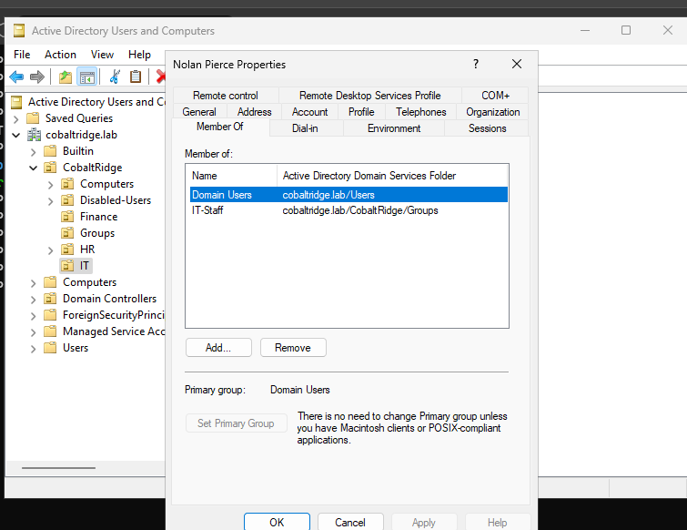 | 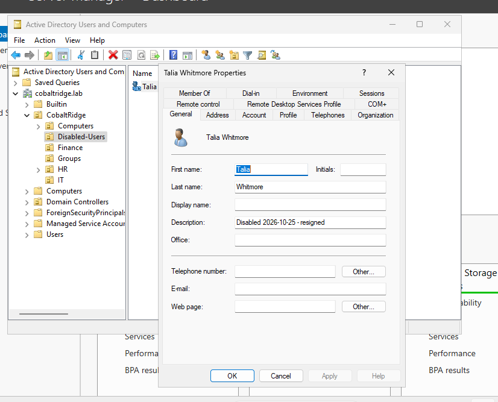 |
| ---------------------------------- | ---------------------------------------- |
| *Screenshot: Nolan Pierce's Member Of tab showing IT-Staff only after the move.* | *Screenshot: Talia Whitmore's disabled account inside the Disabled-Users OU, with the description note.* |

---

### 9. Checked the Evidence in Event Viewer

**Scenario:** Good administrators do not just make changes, they can **prove** them. The domain controller keeps a diary of account activity in the **Security log**. I used it to find the actions I had just performed.

**Events I looked for:**

| Event ID | What it means | Where I caused it |
| -------- | ------------- | ----------------- |
| 4720 | A user account was created | Sections 4 and 8 (new users) |
| 4725 | A user account was disabled | Section 8 (Talia's account) |
| 4740 | A user account was locked out | Section 7 (lockout test) |
| 4728 | A member was added to a security group | Sections 4 and 8 |
| 4729 | A member was removed from a security group | Section 8 (Nolan's move) |

**Steps:**

1. On `CRF-DC01`, opened **Event Viewer → Windows Logs → Security**.
2. Clicked **Filter Current Log...** on the right, typed `4720, 4725, 4740, 4728, 4729` into the **Event IDs** box, and clicked **OK**.
3. Opened a few events and read the details: **who** did it (the account that made the change), **which account** it happened to, and **when**.
4. **Optional PowerShell version:**

   ```powershell
   Get-WinEvent -FilterHashtable @{ LogName = "Security"; Id = 4720,4725,4740,4728,4729 } -MaxEvents 20 |
       Select-Object TimeCreated, Id, Message | Format-Table -Wrap
   ```

   > If an event is missing, check you are looking at the **Security** log on `CRF-DC01`, and that you actually performed the action first.

|  |  |
| -------------------------------------------- | ------------------------------------- |
| *Screenshot: The Filter Current Log window with the event IDs entered.* | *Screenshot: Events 4720, 4725 and 4740 listed with their timestamps.* |

---

## Validation Checklist

Before calling the lab finished, I checked every request from my manager against a real test:

| # | Request | Test | Expected result | Status |
| - | ------- | ---- | --------------- | ------ |
| 1 | One sign-in everywhere | Sign in to CRF-WKS01 as a domain user | Success, forced password change on first use | Pass / Fail |
| 2 | Department folders | Finance user opens the HR share | Access denied | Pass / Fail |
| 2 | Department folders | Auditor creates a folder in Finance | Access denied (read-only works) | Pass / Fail |
| 3 | Password rules | Set a weak password | Rejected | Pass / Fail |
| 3 | Lockout | Five wrong passwords | Account locked, unlocks after 30 minutes or by an admin | Pass / Fail |
| 3 | HR restriction | HR user opens Command Prompt | Blocked; Finance user is unaffected | Pass / Fail |
| 4 | Joiner | New user signs in | Right OU, right group, can open own department share | Pass / Fail |
| 4 | Mover | Moved user opens old department share | Access denied | Pass / Fail |
| 4 | Leaver | Disabled user tries to sign in | "Your account has been disabled" | Pass / Fail |
| 4 | Evidence | Filter the Security log | 4720, 4725, 4740 found with timestamps | Pass / Fail |

---

## Troubleshooting

| Symptom | Likely cause | What I did |
| ------- | ------------ | ---------- |
| "The specified domain does not exist or could not be contacted" when joining | The PC's DNS is not the domain controller, or the VMs are on different networks | Set DNS to `10.10.10.10`, confirmed both adapters are **Host-only**, and ran `Resolve-DnsName cobaltridge.lab` |
| The two VMs cannot ping each other | Windows Firewall or wrong IP settings | Rechecked both IPs and the subnet mask; ping from the PC to `10.10.10.10` |
| A user still can or cannot open a folder after I changed groups | Group membership is read at sign-in | Signed out and signed back in |
| A Group Policy is not working | The policy has not refreshed, or the user is in the wrong OU | Ran `gpupdate /force`, signed out and in, and checked the user sits in the OU the policy is linked to |
| "Access denied" even for the right group | Inheritance was not disabled, or a wrong group was given permission | Reopened the folder's **Security → Advanced** and compared it with Section 5 |
| Windows 11 will not install ("This PC can't run Windows 11") | No virtual TPM or Secure Boot | Followed the TPM steps in Section 1, including encrypting the VM |
| I locked myself out of a test account | The lockout policy worked | Unlocked it in ADUC: user properties → **Account** tab → **Unlock account** |

---

## Key Takeaways

- **A domain is a single source of truth** — One list of users, passwords and computers on the domain controller means one sign-in works on every company PC.
- **DNS is the first thing to check** — Almost every domain-join problem comes down to the PC not using the domain controller for DNS.
- **OUs are for organizing and for targeting** — Folders for users matter because a Group Policy can be aimed at one OU, like HR, without affecting anyone else.
- **Groups, not people** — Giving access to a group means that when someone changes jobs, I change their groups and the access follows. It also makes it easy to answer "who can open this folder?"
- **Share permissions and NTFS permissions work together** — The stricter one wins. I kept the share broad and did the real restricting with NTFS and groups.
- **Test every rule with a real user** — A setting that looks right in a dialog can still fail in practice. Signing in as the person is the only real proof.
- **Order matters in a role change** — Remove the old access first, then add the new access.
- **Leavers are a security job** — A disabled, stripped, clearly separated account is far safer than an old account left active "just in case".
- **Evidence matters** — The Security log let me prove who created, disabled and locked out accounts, and when.

---

## Next Steps (When You Are Ready for More)

This lab is the foundation. The **Advanced** version of the same scenario builds on it with:

- A separate **file server** instead of putting shares on the domain controller
- A proper **AGDLP** group model (global groups for roles, domain local groups for resources)
- **Delegation of control**, so the help desk can reset passwords without being Domain Admins
- A **separate admin account** with a stricter fine-grained password policy, blocked from signing in to workstations
- **Advanced audit policy** and an **access review report**
- Joiner, Mover and Leaver as a reusable **PowerShell toolkit** with a log

Other good next projects: syncing this domain to **Microsoft Entra ID**, or putting the admin account in a **privileged access management** vault.

---

## Suggested Repository Structure

```
cobalt-ridge-ad-fundamentals-lab/
├── README.md
├── Lab.md
├── img/
│   ├── 01_vm_network_host_only.png
│   ├── 02_vm_inventory.png
│   ├── 03_static_ip_dc.png
│   ├── 04_add_roles_adds.png
│   ├── 05_new_forest_cobaltridge_lab.png
│   ├── 06_get_addomain_output.png
│   ├── 07_ou_structure.png
│   ├── 08_new_user_wizard.png
│   ├── 09_users_and_groups_in_aduc.png
│   ├── 10_share_ntfs_permissions_finance.png
│   ├── 11_domain_join_success.png
│   ├── 12_finance_user_can_write.png
│   ├── 13_finance_user_denied_hr.png
│   ├── 14_password_policy_values.png
│   ├── 15_weak_password_rejected.png
│   ├── 16_account_locked_out.png
│   ├── 17_hr_gpo_command_prompt.png
│   ├── 18_cmd_disabled_message.png
│   ├── 19_mover_group_change.png
│   ├── 20_leaver_disabled_users_ou.png
│   ├── 21_event_viewer_security_filter.png
│   └── 22_events_4720_4725_4740.png
└── scripts/
    ├── 01-Create-OUs.ps1
    ├── 02-Create-Users-and-Groups.ps1
    ├── 03-Create-Shares.ps1
    └── 04-Lifecycle-Examples.ps1
```

---

## Lab Prerequisites (if you are reproducing this)

- A 64-bit Windows computer with virtualization (VT-x or AMD-V) turned on in BIOS, at least **12 GB RAM** (16 GB is more comfortable), and about 100 GB of free disk space
- **VMware Workstation Pro**
- Windows Server **evaluation** ISO and Windows 11 Enterprise **evaluation** ISO from the Microsoft Evaluation Center
- Two VMs sized as in Section 1, both on a **Host-only** network
- Patience: the first Windows installs and the domain controller promotion take a while, and that is normal

> This lab is for learning. Do not run these steps on a real company's domain, and before publishing screenshots, check that no password or prompt is visible.

---

*This project is the entry-level hands-on track for Active Directory administration, built entirely on VMware Workstation with a fictional bank as the scenario. Every section is meant to be repeatable by a beginner, with a test and a visible result for each rule that was set.*
