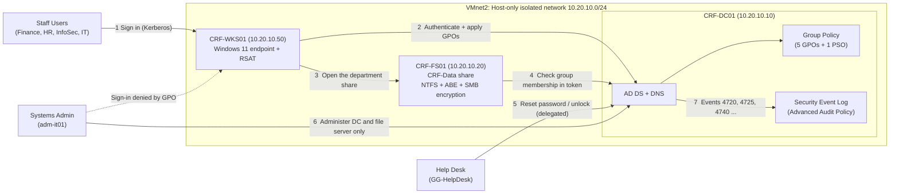
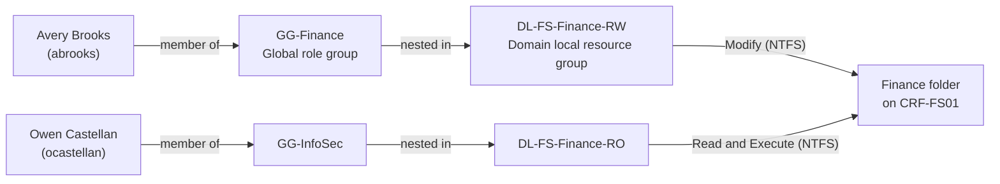

# Cobalt Ridge Financial: Secure Active Directory Identity Lab (VMware Workstation)

A scenario-based, hardened Active Directory build for a fictional regional bank, **Cobalt Ridge Financial**, with a headquarters in Denver and an operations center in Charlotte. I built it entirely in **VMware Workstation** (no cloud subscription needed) after an internal audit came back with six identity findings. Every control is configured, then **tested with real user accounts**, then proven with an event in the log.

> **Fictional environment:** every company, person, ticket number and address in this lab is made up. The lab network is isolated by design.

**The six audit findings I set out to close:**

| ID | Audit finding | Risk if left alone | Fixed in |
| -- | ------------- | ------------------ | -------- |
| F1 | IT staff use one shared admin account for everything, including on user workstations | One stolen credential on a laptop becomes full domain compromise | Sections 3, 8 |
| F2 | Passwords are 8 characters, never expire, and there is no lockout | Brute force and password spraying succeed quietly | Sections 3, 8 |
| F3 | Folder access is granted to individuals; everyone can browse every department share | Excess access and no clean way to review who can see what | Section 6 |
| F4 | Help desk staff are Domain Admins just to reset passwords | Massive over-privilege for a routine task | Section 7 |
| F5 | Leavers stay enabled; people who change roles keep their old access | Orphaned accounts and privilege creep | Sections 4, 9 |
| F6 | No audit trail for account changes, lockouts or group changes | No detection and no forensics | Sections 8, 10 |

---

## Architecture



*Privileged accounts can sign in to the domain controller and the file server, but a Group Policy denies them on workstations, so an admin password is never typed into a machine a user (or malware) controls.*

### How access is granted: AGDLP



*Nobody is ever granted access directly. Accounts go into Global groups, Global groups go into Domain Local groups, and Domain Local groups receive the Permissions (AGDLP). An access review becomes a group-membership review.*

---

## What I Did

### 1. Built an Isolated VMware Workstation Lab and Promoted the Domain Controller

**Scenario:** I did not want to practise on production, and I did not want a lab full of weak test accounts reachable from my home network. So the first security decision happens before Active Directory exists: the lab network is a private island, and each VM is patched on NAT first and then moved onto the island.

**Lab machines:**

| VM name | Role | OS | vCPU / RAM / Disk | IP address |
| ------- | ---- | -- | ----------------- | ---------- |
| `CRF-DC01` | Domain controller, DNS, Group Policy | Windows Server (Desktop Experience), evaluation | 2 / 4 GB / 60 GB | 10.20.10.10 |
| `CRF-FS01` | Member file server (department shares) | Windows Server (Desktop Experience), evaluation | 2 / 3 GB / 60 GB + 20 GB data disk | 10.20.10.20 |
| `CRF-WKS01` | Domain-joined employee endpoint | Windows 11 Enterprise, evaluation | 2 / 4 GB / 64 GB | 10.20.10.50 |

**Steps:**

1. Downloaded the Windows Server and Windows 11 Enterprise **evaluation ISOs** from the Microsoft Evaluation Center. Evaluation editions are time-limited, which is fine for a lab. The commands below work the same on Windows Server 2022 and 2025.

2. Created the **isolated virtual network** in **Edit → Virtual Network Editor → Change Settings**:

   - Added network `VMnet2` with type **Host-only**
   - Set Subnet IP to `10.20.10.0` and mask to `255.255.255.0`
   - **Unticked** *Use local DHCP service*, because the domain controller will own DNS and I will use static addresses
   - **Unticked** *Connect a host virtual adapter to this network*, which is what makes the network truly isolated. I manage every VM through the VMware console.

3. Created the three VMs using **File → New Virtual Machine → Custom**, sized as in the table above. For each VM:

   - Set the network adapter to **NAT** for now
   - Installed the OS (for servers, the *Standard Evaluation (Desktop Experience)* edition)
   - Installed **VMware Tools** and ran Windows Update until nothing was left
   - Shut down, changed the adapter to **Custom: VMnet2**, and took a snapshot named `01-clean-patched`

4. For `CRF-WKS01`, enabled the **virtual TPM** that Windows 11 needs:

   - **Options → Advanced:** firmware type **UEFI**, tick **Secure Boot**
   - **Options → Access Control:** **Encrypt** the VM and set a password (VMware requires this before it allows a virtual TPM)
   - **Hardware → Add → Trusted Platform Module**
   - During setup, created a local account named `localadmin`. The domain join comes later.

5. On `CRF-DC01`, set the name, a **static IP with no default gateway** (the network is isolated), and **DNS pointing only at itself**. No public resolver such as 8.8.8.8 is configured on any domain machine, because a public alternate DNS makes clients intermittently fail to find the domain.

   ```powershell
   Get-NetAdapter | Select-Object Name, Status, InterfaceDescription
   Rename-Computer -NewName "CRF-DC01" -Restart

   # after the restart
   New-NetIPAddress -InterfaceAlias "Ethernet0" -IPAddress 10.20.10.10 -PrefixLength 24
   Set-DnsClientServerAddress -InterfaceAlias "Ethernet0" -ServerAddresses 10.20.10.10
   ```

   > If `Get-NetAdapter` shows a different adapter name (for example `Ethernet0 2`), use that name in the commands.

6. Installed **AD DS** and created a **new forest**. I used a `.lab` suffix so the name can never collide with a real internet domain. When prompted, I set a strong **DSRM (Directory Services Restore Mode) password**, which is the break-glass password for offline repair, and stored it in my password manager only.

   ```powershell
   Install-WindowsFeature AD-Domain-Services -IncludeManagementTools

   Install-ADDSForest -DomainName "corp.cobaltridge.lab" -DomainNetbiosName "COBALTRIDGE" -InstallDns -SafeModeAdministratorPassword (Read-Host -Prompt "DSRM password" -AsSecureString)
   ```

   A warning that a **DNS delegation cannot be created** is expected in an isolated lab, because there is no parent DNS zone. I continued.

7. After the restart, signed in as `COBALTRIDGE\Administrator` and **verified the domain controller was healthy**:

   ```powershell
   Get-ADDomain | Select-Object Name, DNSRoot, NetBIOSName, DomainMode
   Get-ADForest | Select-Object Name, ForestMode
   dcdiag /q
   nslookup crf-dc01.corp.cobaltridge.lab
   ```

   `dcdiag /q` prints nothing when every test passes. Quiet is the result I want.

8. Applied three small **hardening steps** that cost nothing:

   ```powershell
   # AD Recycle Bin: deleted objects can be restored (cannot be undone, which is fine)
   Enable-ADOptionalFeature -Identity "Recycle Bin Feature" -Scope ForestOrConfigurationSet -Target "corp.cobaltridge.lab" -Confirm:$false

   # Disable the legacy SMBv1 protocol
   Set-SmbServerConfiguration -EnableSMB1Protocol $false -Force

   # Confirm both
   (Get-ADOptionalFeature -Filter "Name -eq 'Recycle Bin Feature'").EnabledScopes
   Get-SmbServerConfiguration | Select-Object EnableSMB1Protocol
   ```

9. Took the snapshot `02-dc-promoted`. From here on, **every section ends with a snapshot**, so if a Group Policy locks me out or a script goes wrong I roll back in a minute instead of rebuilding.

|  |  |
| --------------------------------------------- | ------------------------------------------- |
| *Screenshot: Virtual Network Editor showing VMnet2 as Host-only, subnet 10.20.10.0/24, with both checkboxes cleared.* | *Screenshot: The three VMs in VMware Workstation and the network adapter page set to Custom: VMnet2.* |
|  |  |
| *Screenshot: The successful domain controller promotion message (DSRM password hidden).* | *Screenshot: `Get-ADDomain` output and a clean `dcdiag /q` result on CRF-DC01.* |

---

### 2. Designed the Directory: OU Structure and AGDLP Role Groups

**Scenario:** Cobalt Ridge thinks about people by **site first and department second**, so I mirrored that. The structure lets me point a policy or a delegation at exactly one site or one department without touching anyone else. I also separated *who someone is* (role groups) from *what can be touched* (resource groups), because that separation is what makes access reviews easy later.

**Target OU design:**

```
corp.cobaltridge.lab
└── CobaltRidge
    ├── Sites
    │   ├── HQ-Denver
    │   │   ├── Computers
    │   │   ├── Servers
    │   │   └── Users
    │   │       ├── Finance
    │   │       ├── HR
    │   │       ├── InfoSec
    │   │       └── IT-Support
    │   └── OPS-Charlotte        (same layout as HQ-Denver)
    ├── Groups
    │   ├── Role-Groups          (global groups: who you are)
    │   └── Resource-Groups      (domain local groups: what you can touch)
    ├── Admin Accounts           (privileged accounts only, outside every delegation)
    ├── Service Accounts
    └── Disabled-Users           (quarantine for leavers)
```

**Group plan:**

| Group | Scope | Purpose |
| ----- | ----- | ------- |
| `GG-Finance`, `GG-HR`, `GG-InfoSec`, `GG-IT-Support` | Global | One role group per department; membership *is* the job |
| `GG-HelpDesk` | Global | Subset of IT-Support allowed to reset passwords (Section 7) |
| `GG-Tier0-Admins` | Global | Privileged accounts only (Section 3) |
| `DL-FS-Finance-RW` / `DL-FS-Finance-RO` | Domain Local | Modify or read-only on the Finance share |
| `DL-FS-HR-RW` / `DL-FS-HR-RO` | Domain Local | Modify or read-only on the HR share |
| `DL-FS-InfoSec-RW`, `DL-FS-IT-RW` | Domain Local | Modify on the InfoSec and IT-Support shares |

**Steps:**

1. Built the whole OU tree and every group with one script instead of clicking, so the structure is identical every time I rebuild the lab. OUs created from PowerShell are **protected from accidental deletion** by default, which I kept.

   <details>
   <summary><strong>scripts/01-Build-OUs-and-Groups.ps1</strong> (click to expand)</summary>

   ```powershell
   <#
     01-Build-OUs-and-Groups.ps1
     Run on : CRF-DC01 (elevated PowerShell, signed in as a Domain Admin)
     Purpose: Build the CobaltRidge OU tree, the role (global) and resource (domain local)
              groups, and redirect new computer accounts into a managed OU.
   #>
   Import-Module ActiveDirectory

   $dn   = (Get-ADDomain).DistinguishedName
   $root = "OU=CobaltRidge,$dn"

   # ---- OU tree ----------------------------------------------------------------
   New-ADOrganizationalUnit -Name "CobaltRidge" -Path $dn
   "Sites","Groups","Admin Accounts","Service Accounts","Disabled-Users" |
       ForEach-Object { New-ADOrganizationalUnit -Name $_ -Path $root }

   foreach ($site in "HQ-Denver","OPS-Charlotte") {
       $sitePath = "OU=$site,OU=Sites,$root"
       New-ADOrganizationalUnit -Name $site -Path "OU=Sites,$root"
       "Computers","Servers","Users" |
           ForEach-Object { New-ADOrganizationalUnit -Name $_ -Path $sitePath }
       "Finance","HR","InfoSec","IT-Support" |
           ForEach-Object { New-ADOrganizationalUnit -Name $_ -Path "OU=Users,$sitePath" }
   }

   "Role-Groups","Resource-Groups" |
       ForEach-Object { New-ADOrganizationalUnit -Name $_ -Path "OU=Groups,$root" }

   # ---- Groups (AGDLP) --------------------------------------------------------
   $roleOU = "OU=Role-Groups,OU=Groups,$root"
   $resOU  = "OU=Resource-Groups,OU=Groups,$root"

   # Global groups = WHO you are (roles)
   "GG-Finance","GG-HR","GG-InfoSec","GG-IT-Support","GG-HelpDesk","GG-Tier0-Admins" |
       ForEach-Object {
           New-ADGroup -Name $_ -GroupScope Global -GroupCategory Security -Path $roleOU -Description "Role group: $_"
       }

   # Domain local groups = WHAT can be touched (resources)
   "DL-FS-Finance-RW","DL-FS-Finance-RO","DL-FS-HR-RW","DL-FS-HR-RO","DL-FS-InfoSec-RW","DL-FS-IT-RW" |
       ForEach-Object {
           New-ADGroup -Name $_ -GroupScope DomainLocal -GroupCategory Security -Path $resOU -Description "Resource group: $_"
       }

   # ---- New computers land in a managed OU (where GPOs can be linked) ---------
   redircmp "OU=Computers,OU=HQ-Denver,OU=Sites,OU=CobaltRidge,$dn"

   # ---- Quick check -----------------------------------------------------------
   Get-ADOrganizationalUnit -Filter * -SearchBase $root | Select-Object Name, DistinguishedName
   Get-ADGroup -Filter * -SearchBase "OU=Groups,$root" | Select-Object Name, GroupScope | Sort-Object Name
   ```

   </details>

2. Noted the last command in the script, `redircmp`. By default a new computer lands in the generic `Computers` container, where **Group Policy cannot be linked**. Redirecting new computer accounts to my Denver computers OU means a machine is managed from the moment it joins.

3. Verified the result in **Active Directory Users and Computers** and with the two query commands at the bottom of the script (all 6 role groups as `Global`, all 6 resource groups as `DomainLocal`).

4. Took snapshot `03-directory-designed`.

|  |  |
| ---------------------------- | ---------------------------------------- |
| *Screenshot: Active Directory Users and Computers expanded to show the full CobaltRidge OU tree.* | *Screenshot: Role-Groups and Resource-Groups OUs listing the global and domain local groups.* |

---

### 3. Created Privileged Accounts with a Stricter Fine-Grained Password Policy

**Scenario:** Audit findings F1 and F2 carry the most risk, so they came first. Nobody should do daily work with an account that can rewrite the whole directory, and an admin account deserves a tougher password policy than an ordinary employee.

**Steps:**

1. Created a **separate, named privileged account**, `adm-it01`, in the **Admin Accounts** OU. It has no mailbox and I never use it to browse the web. The password is typed at the prompt, so it is **never stored in a script or a screenshot**, and it is at least 16 characters long because the stricter admin policy applies to it.

   ```powershell
   $dn     = (Get-ADDomain).DistinguishedName
   $secure = Read-Host -Prompt "Password for adm-it01 (16+ characters)" -AsSecureString

   New-ADUser -Name "adm-it01" -SamAccountName "adm-it01" -UserPrincipalName "adm-it01@corp.cobaltridge.lab" -DisplayName "IT Admin 01 (privileged)" -Description "Tier 0 admin account. No email, no web browsing." -Path "OU=Admin Accounts,OU=CobaltRidge,$dn" -AccountPassword $secure -Enabled $true

   Add-ADGroupMember -Identity "Domain Admins"   -Members "adm-it01"
   Add-ADGroupMember -Identity "GG-Tier0-Admins" -Members "adm-it01"
   ```

   > I deliberately did **not** add the account to *Protected Users* yet. That group blocks NTLM, and a domain join can use NTLM, so I add it in Section 8, after both machines have joined.

2. Created a **fine-grained password policy (PSO)** and attached it to the Tier-0 group. A PSO overrides the domain-wide policy for its members only.

   ```powershell
   $pso = @{
       Name                        = "PSO-Privileged"
       Precedence                  = 10
       MinPasswordLength           = 16
       PasswordHistoryCount        = 24
       ComplexityEnabled           = $true
       ReversibleEncryptionEnabled = $false
       MinPasswordAge              = "1.00:00:00"
       MaxPasswordAge              = "60.00:00:00"
       LockoutThreshold            = 3
       LockoutObservationWindow    = "00:30:00"
       LockoutDuration             = "00:30:00"
   }
   New-ADFineGrainedPasswordPolicy @pso
   Add-ADFineGrainedPasswordPolicySubject -Identity "PSO-Privileged" -Subjects "GG-Tier0-Admins"
   ```

3. **Proved the PSO applies.** This command must report `PSO-Privileged`, a minimum length of 16 and a lockout threshold of 3:

   ```powershell
   Get-ADUserResultantPasswordPolicy -Identity "adm-it01" | Select-Object Name, MinPasswordLength, LockoutThreshold
   ```

4. Treated the built-in `Administrator` as a **break-glass account**: stopped using it for anything routine, reset it to a long random password, and sealed that password away for emergencies only. In a real bank this credential would live in a **privileged access management vault** with check-out, rotation and session recording.

   ```powershell
   Set-ADAccountPassword -Identity "Administrator" -Reset -NewPassword (Read-Host -Prompt "New break-glass password" -AsSecureString)
   ```

5. Took snapshot `04-privileged-accounts`.

|  |  |
| ----------------------------------------- | ------------------------------------------------- |
| *Screenshot: `Get-ADUserResultantPasswordPolicy` for adm-it01 showing PSO-Privileged. No password prompts visible.* | *Screenshot: The Admin Accounts OU and the members of GG-Tier0-Admins.* |

---

### 4. Built an Identity Lifecycle Toolkit and Onboarded the Workforce (Joiner)

**Scenario:** Finding F5 came from manual account handling, and people forget steps when they are busy. I wrote one small toolkit so that **every Joiner, Mover and Leaver follows the same sequence** and leaves the same trail in a log.

**What the toolkit does:**

| Function | What it does |
| -------- | ------------ |
| `New-TempPassword` | Builds a random password with a cryptographic random generator and checks it meets complexity rules |
| `New-CRFUser` | Creates the account in the correct OU, adds the correct role group, forces a password change at first sign-in, and can set an expiry date for contractors |
| `Move-CRFUser` | Removes **all** old role groups first, then moves the account, then grants the new role |
| `Disable-CRFUser` | Cuts access immediately, invalidates the old password, strips groups and quarantines the account |
| `Write-CRFLog` | Records each action with a timestamp and the administrator who ran it |

**Steps:**

1. Saved the toolkit as `C:\CRF\02-CRF-IdentityToolkit.ps1` on `CRF-DC01`. No password is hard-coded anywhere: each temporary password is generated in memory.

   <details>
   <summary><strong>scripts/02-CRF-IdentityToolkit.ps1</strong> (click to expand)</summary>

   ```powershell
   <#
     02-CRF-IdentityToolkit.ps1  -  Cobalt Ridge Financial identity lifecycle toolkit
     Run on : CRF-DC01. Load it with:  . C:\CRF\02-CRF-IdentityToolkit.ps1
     Provides: Write-CRFLog, New-TempPassword, New-CRFUser, Move-CRFUser, Disable-CRFUser
   #>
   Import-Module ActiveDirectory

   $global:CRFDomainDN = (Get-ADDomain).DistinguishedName
   $global:CRFDnsRoot  = (Get-ADDomain).DNSRoot
   $global:CRFSiteRoot = "OU=Sites,OU=CobaltRidge,$global:CRFDomainDN"
   $global:CRFLogPath  = "C:\CRF\Logs\lifecycle.csv"

   function Write-CRFLog {
       param([string]$Action, [string]$User, [string]$Details)
       New-Item -ItemType Directory -Path (Split-Path $global:CRFLogPath) -Force | Out-Null
       [pscustomobject]@{
           Timestamp   = (Get-Date).ToString("yyyy-MM-dd HH:mm:ss")
           PerformedBy = $env:USERNAME
           Action      = $Action
           User        = $User
           Details     = $Details
       } | Export-Csv -Path $global:CRFLogPath -Append -NoTypeInformation
   }

   function New-TempPassword {
       param([int]$Length = 16)
       $sets = @('ABCDEFGHJKLMNPQRSTUVWXYZ', 'abcdefghijkmnopqrstuvwxyz', '23456789', '!@#$%&*?-_=+')
       $all  = -join $sets
       $rng  = [System.Security.Cryptography.RandomNumberGenerator]::Create()
       do {
           $bytes = New-Object byte[] $Length
           $rng.GetBytes($bytes)
           $candidate = -join ($bytes | ForEach-Object { $all[$_ % $all.Length] })
       } until (($sets | Where-Object { $candidate.IndexOfAny($_.ToCharArray()) -ge 0 }).Count -eq 4)
       $candidate
   }

   function New-CRFUser {
       [CmdletBinding()]
       param(
           [Parameter(Mandatory)][string]$First,
           [Parameter(Mandatory)][string]$Last,
           [Parameter(Mandatory)][ValidateSet('Finance','HR','InfoSec','IT-Support')][string]$Dept,
           [Parameter(Mandatory)][ValidateSet('HQ-Denver','OPS-Charlotte')][string]$Site,
           [Parameter(Mandatory)][string]$Title,
           [int]$ExpiresInDays
       )
       $sam  = ($First.Substring(0,1) + $Last).ToLower() -replace '[^a-z0-9]', ''
       $temp = New-TempPassword
       $params = @{
           Name                  = "$First $Last"
           GivenName             = $First
           Surname               = $Last
           DisplayName           = "$First $Last"
           SamAccountName        = $sam
           UserPrincipalName     = "$sam@$global:CRFDnsRoot"
           Title                 = $Title
           Department            = $Dept
           Office                = $Site
           Path                  = "OU=$Dept,OU=Users,OU=$Site,$global:CRFSiteRoot"
           AccountPassword       = (ConvertTo-SecureString $temp -AsPlainText -Force)
           ChangePasswordAtLogon = $true
           Enabled               = $true
       }
       New-ADUser @params
       Add-ADGroupMember -Identity "GG-$Dept" -Members $sam
       if ($ExpiresInDays) {
           Set-ADAccountExpiration -Identity $sam -TimeSpan ([timespan]::FromDays($ExpiresInDays))
       }
       Write-CRFLog -Action "JOINER" -User $sam -Details "Created in $Dept / $Site; group GG-$Dept; expiry days: $ExpiresInDays"
       [pscustomobject]@{ SamAccountName = $sam; TempPassword = $temp }
   }

   function Move-CRFUser {
       [CmdletBinding()]
       param(
           [Parameter(Mandatory)][string]$Sam,
           [Parameter(Mandatory)][ValidateSet('Finance','HR','InfoSec','IT-Support')][string]$NewDept,
           [Parameter(Mandatory)][ValidateSet('HQ-Denver','OPS-Charlotte')][string]$NewSite,
           [string]$NewTitle
       )
       $user   = Get-ADUser -Identity $Sam -Properties Department
       $oldGrp = Get-ADPrincipalGroupMembership -Identity $Sam | Where-Object { $_.Name -like 'GG-*' }

       # 1) Revoke old role access FIRST (remove before add)
       foreach ($g in $oldGrp) { Remove-ADGroupMember -Identity $g -Members $Sam -Confirm:$false }

       # 2) Move the object so the correct policies apply
       Move-ADObject -Identity $user.DistinguishedName -TargetPath "OU=$NewDept,OU=Users,OU=$NewSite,$global:CRFSiteRoot"

       # 3) Update attributes, then grant the new role
       $set = @{ Identity = $Sam; Department = $NewDept; Office = $NewSite }
       if ($NewTitle) { $set.Title = $NewTitle }
       Set-ADUser @set
       Add-ADGroupMember -Identity "GG-$NewDept" -Members $Sam

       Write-CRFLog -Action "MOVER" -User $Sam -Details "From $($user.Department): removed [$($oldGrp.Name -join ';')]; now $NewDept / $NewSite"
   }

   function Disable-CRFUser {
       [CmdletBinding()]
       param(
           [Parameter(Mandatory)][string]$Sam,
           [Parameter(Mandatory)][string]$Ticket
       )
       $user   = Get-ADUser -Identity $Sam
       $groups = Get-ADPrincipalGroupMembership -Identity $Sam | Where-Object { $_.Name -ne 'Domain Users' }
       $junk   = ConvertTo-SecureString (New-TempPassword 24) -AsPlainText -Force

       # 1) Cut access immediately
       Disable-ADAccount -Identity $Sam
       # 2) Invalidate the old credential so a re-enable cannot revive it
       Set-ADAccountPassword -Identity $Sam -Reset -NewPassword $junk
       # 3) Strip every group except Domain Users
       foreach ($g in $groups) { Remove-ADGroupMember -Identity $g -Members $Sam -Confirm:$false }
       # 4) Annotate and quarantine
       Set-ADUser -Identity $Sam -Description "Disabled $(Get-Date -Format yyyy-MM-dd) | Ticket $Ticket"
       Move-ADObject -Identity $user.DistinguishedName -TargetPath "OU=Disabled-Users,OU=CobaltRidge,$global:CRFDomainDN"

       Write-CRFLog -Action "LEAVER" -User $Sam -Details "Disabled, password reset, removed [$($groups.Name -join ';')], ticket $Ticket"
   }
   ```

   </details>

2. HR sent a spreadsheet of staff, which I saved as `C:\CRF\crf-users.csv` (eleven people across two sites and four departments; see [`data/crf-users.csv`](data/crf-users.csv)).

3. Loaded the toolkit and onboarded everyone in one pass. The two help desk technicians also joined the delegated help desk role used in Section 7.

   ```powershell
   Set-ExecutionPolicy RemoteSigned -Scope Process -Force
   . C:\CRF\02-CRF-IdentityToolkit.ps1

   $onboard = Import-Csv C:\CRF\crf-users.csv | ForEach-Object {
       New-CRFUser -First $_.First -Last $_.Last -Dept $_.Dept -Site $_.Site -Title $_.Title
   }

   Add-ADGroupMember -Identity "GG-HelpDesk" -Members "ebrandt","rhartley"
   ```

4. **Handled the temporary passwords like the secrets they are.** The `$onboard` variable holds each person's temporary password for this session only. I kept the window open to sign in with a few test users, then ran `Clear-Host` and closed it. I never screenshot `$onboard`. If I lose a test password I reset it with `Set-ADAccountPassword -Identity <user> -Reset` and a new value typed at the prompt.

5. **Verified the onboarding:**

   ```powershell
   $dn = (Get-ADDomain).DistinguishedName
   Get-ADUser -Filter * -SearchBase "OU=Sites,OU=CobaltRidge,$dn" -Properties Department, Title, Office |
       Select-Object SamAccountName, Department, Office, Title | Sort-Object Department, SamAccountName | Format-Table -AutoSize

   Get-ADGroupMember -Identity "GG-Finance" | Select-Object Name, SamAccountName
   Import-Csv C:\CRF\Logs\lifecycle.csv | Format-Table -AutoSize
   ```

6. Took snapshot `05-users-provisioned`.

|  |  |
| ------------------------------------ | ------------------------------------- |
| *Screenshot: The user table by department and site (without the `$onboard` output).* | *Screenshot: `lifecycle.csv` showing one JOINER entry per onboarded user.* |

---

### 5. Joined the File Server and the Windows 11 Endpoint to the Domain

**Scenario:** This is the step that turns a standalone computer into a managed corporate endpoint (the "domain-joined endpoint" in the lab's original brief). Everything depends on one rule: **domain members must use the domain controller for DNS**.

**Steps:**

1. On `CRF-FS01` (adapter already on VMnet2), set the static address and domain DNS, confirmed the domain name resolves, then joined the domain into the **Servers** OU:

   ```powershell
   New-NetIPAddress -InterfaceAlias "Ethernet0" -IPAddress 10.20.10.20 -PrefixLength 24
   Set-DnsClientServerAddress -InterfaceAlias "Ethernet0" -ServerAddresses 10.20.10.10

   Resolve-DnsName corp.cobaltridge.lab        # must return 10.20.10.10

   Add-Computer -DomainName "corp.cobaltridge.lab" -NewName "CRF-FS01" -OUPath "OU=Servers,OU=HQ-Denver,OU=Sites,OU=CobaltRidge,DC=corp,DC=cobaltridge,DC=lab" -Credential (Get-Credential "COBALTRIDGE\adm-it01") -Restart
   ```

2. On `CRF-WKS01`, **temporarily set the adapter back to NAT** and installed the **Remote Server Administration Tools** (RSAT) while it still had internet, so a help desk user can run Active Directory commands from this machine in Section 7:

   ```powershell
   Add-WindowsCapability -Online -Name "Rsat.ActiveDirectory.DS-LDS.Tools~~~~0.0.1.0"
   Add-WindowsCapability -Online -Name "Rsat.GroupPolicy.Management.Tools~~~~0.0.1.0"
   ```

3. Switched the adapter to **VMnet2**, set the static address and domain DNS, and joined the domain into the Denver **Computers** OU:

   ```powershell
   New-NetIPAddress -InterfaceAlias "Ethernet0" -IPAddress 10.20.10.50 -PrefixLength 24
   Set-DnsClientServerAddress -InterfaceAlias "Ethernet0" -ServerAddresses 10.20.10.10

   Add-Computer -DomainName "corp.cobaltridge.lab" -NewName "CRF-WKS01" -OUPath "OU=Computers,OU=HQ-Denver,OU=Sites,OU=CobaltRidge,DC=corp,DC=cobaltridge,DC=lab" -Credential (Get-Credential "COBALTRIDGE\adm-it01") -Restart
   ```

4. **Verified the joins.** On `CRF-DC01`, both machines must sit in the right OU; on `CRF-WKS01`, the domain and the domain controller it found must be correct:

   ```powershell
   # On CRF-DC01
   Get-ADComputer -Filter * -Properties OperatingSystem | Select-Object Name, OperatingSystem, DistinguishedName

   # On CRF-WKS01
   (Get-CimInstance Win32_ComputerSystem).Domain
   nltest /dsgetdc:corp.cobaltridge.lab
   ```

5. Signed in to `CRF-WKS01` as `COBALTRIDGE\abrooks` with the temporary password. Windows **forced me to set a new one**, which is exactly the Joiner behavior I designed.

6. Took snapshot `06-domain-joined` on all three VMs.

> **If the join fails:** nine times out of ten the cause is DNS. Run `Resolve-DnsName corp.cobaltridge.lab` and confirm it returns `10.20.10.10`. The next most common cause is clock drift of more than five minutes, which breaks Kerberos. Keep VMware Tools time synchronization on for all three VMs.

|  |  |
| --------------------------------------- | ------------------------------------------- |
| *Screenshot: System properties on CRF-WKS01 showing the full computer name and domain.* | *Screenshot: `Get-ADComputer` on the DC showing CRF-FS01 in Servers and CRF-WKS01 in Computers.* |

---

### 6. Implemented Role-Based Access to Department Shares (AGDLP)

**Scenario:** Finding F3 worried the auditors most: people could browse the Finance and HR folders because permissions had been handed out one person at a time. I rebuilt the shares so that **membership of a role group is the only way in**. InfoSec must be able to *read* Finance and HR data for audits, but never change it.

**Steps:**

1. Powered off `CRF-FS01`, added a new **20 GB virtual disk** in the VM settings, powered it on, and initialized it as `E:` (the DVD drive normally takes `D:`). Business data stays off the operating system disk.

   ```powershell
   Get-Disk | Where-Object PartitionStyle -eq 'RAW' |
       Initialize-Disk -PartitionStyle GPT -PassThru |
       New-Partition -DriveLetter E -UseMaximumSize |
       Format-Volume -FileSystem NTFS -NewFileSystemLabel "CRF-Data" -Confirm:$false
   ```

2. On `CRF-DC01`, connected role groups to resource groups (the "G into DL" step). Read as sentences, these lines are the business rules:

   ```powershell
   Add-ADGroupMember -Identity "DL-FS-Finance-RW" -Members "GG-Finance"
   Add-ADGroupMember -Identity "DL-FS-Finance-RO" -Members "GG-InfoSec"
   Add-ADGroupMember -Identity "DL-FS-HR-RW"      -Members "GG-HR"
   Add-ADGroupMember -Identity "DL-FS-HR-RO"      -Members "GG-InfoSec"
   Add-ADGroupMember -Identity "DL-FS-InfoSec-RW" -Members "GG-InfoSec"
   Add-ADGroupMember -Identity "DL-FS-IT-RW"      -Members "GG-IT-Support"
   ```

3. Signed in to `CRF-FS01` as `adm-it01` and ran the share script. It does four things a default share does not:

   - **Removes inherited permissions**, so the built-in Users group has no hidden access
   - Grants permissions **only to the domain local resource groups**, never to individuals
   - Turns on **access-based enumeration**, so a user only sees folders they can open
   - Requires **SMB encryption** for the share

   <details>
   <summary><strong>scripts/03-Build-FileShares.ps1</strong> (click to expand)</summary>

   ```powershell
   <#
     03-Build-FileShares.ps1
     Run on : CRF-FS01 (elevated PowerShell, signed in as adm-it01)
     Purpose: Create the department folders, lock down NTFS permissions to the
              domain local resource groups, and publish one encrypted share with
              access-based enumeration. Assumes the E: data disk already exists.
   #>
   $root = "E:\Shares"
   New-Item -ItemType Directory -Path $root -Force | Out-Null

   # Top folder: admins and SYSTEM full control; everyone else may only LIST this one folder
   icacls $root /inheritance:r /grant "BUILTIN\Administrators:(OI)(CI)F" "NT AUTHORITY\SYSTEM:(OI)(CI)F" "NT AUTHORITY\Authenticated Users:(RX)" | Out-Null

   $map = @{
       "Finance"    = @{ RW = "DL-FS-Finance-RW"; RO = "DL-FS-Finance-RO" }
       "HR"         = @{ RW = "DL-FS-HR-RW";      RO = "DL-FS-HR-RO" }
       "InfoSec"    = @{ RW = "DL-FS-InfoSec-RW"; RO = $null }
       "IT-Support" = @{ RW = "DL-FS-IT-RW";      RO = $null }
   }

   foreach ($name in $map.Keys) {
       $path = Join-Path $root $name
       New-Item -ItemType Directory -Path $path -Force | Out-Null
       $icaclsArgs = @($path, "/inheritance:r", "/grant",
           "BUILTIN\Administrators:(OI)(CI)F",
           "NT AUTHORITY\SYSTEM:(OI)(CI)F",
           "COBALTRIDGE\$($map[$name].RW):(OI)(CI)M")
       if ($map[$name].RO) { $icaclsArgs += "COBALTRIDGE\$($map[$name].RO):(OI)(CI)RX" }
       icacls @icaclsArgs | Out-Null
   }

   # One share: broad SHARE permission, strict NTFS permission, hidden folders, encrypted in transit
   New-SmbShare -Name "CRF-Data" -Path $root -FolderEnumerationMode AccessBased -EncryptData $true -ChangeAccess "NT AUTHORITY\Authenticated Users" -FullAccess "BUILTIN\Administrators"

   # Quick check
   icacls "$root\Finance"
   Get-SmbShare -Name "CRF-Data" | Select-Object Name, Path, FolderEnumerationMode, EncryptData
   ```

   </details>

4. Noted the design choice: the **share permission is deliberately broad** (Change for Authenticated Users) and the **NTFS permissions do the real restricting**. When both apply, the stricter one wins, and managing access in one place keeps the model simple to audit.

5. **Tested with four real users.** On `CRF-WKS01` I signed in as each person, opened `\\CRF-FS01\CRF-Data`, and tried to create a new folder in every share I could see:

   | Signed in as | Finance | HR | InfoSec | IT-Support |
   | ------------ | ------- | -- | ------- | ---------- |
   | `abrooks` (Finance) | Modify | Hidden | Hidden | Hidden |
   | `mellery` (HR) | Hidden | Modify | Hidden | Hidden |
   | `ocastellan` (InfoSec) | Read-only | Read-only | Modify | Hidden |
   | `ebrandt` (IT-Support) | Hidden | Hidden | Hidden | Modify |

   *Hidden* is access-based enumeration at work: the folder does not even appear. For the InfoSec read-only rows, **New folder** returned *Destination Folder Access Denied*, which is the evidence for least privilege.

6. Remembered the one gotcha: group memberships are copied into the sign-in token, so after any group change the user must **sign out and back in** before the result changes.

7. Took snapshot `07-shares-done` on `CRF-DC01` and `CRF-FS01`.

|  |  |
| ----------------------------------------------- | ---------------------------------------------- |
| *Screenshot: The Finance share open as abrooks, with a new file created successfully.* | *Screenshot: The "Destination Folder Access Denied" message for ocastellan trying to create a folder in Finance.* |
|  |  |
| *Screenshot: The share listing for mellery showing only the HR folder (access-based enumeration).* | *Screenshot: `icacls` output for the Finance folder showing only the two resource groups, Administrators and SYSTEM.* |

---

### 7. Delegated Password Resets to the Help Desk (No More Domain Admins for Routine Work)

**Scenario:** Finding F4 was almost embarrassing. To reset passwords, the help desk had been made **Domain Admins**, which would also let them delete the domain. I replaced that with a narrow delegation that does exactly one job.

**Steps:**

1. On `CRF-DC01`, opened **Active Directory Users and Computers**, right-clicked the **Sites** OU and chose **Delegate Control**.

2. Added the group `GG-HelpDesk` and ticked two common tasks:

   - **Reset user passwords and force password change at next logon**
   - **Read all user information**

3. Finished the wizard and confirmed the summary listed `GG-HelpDesk` and only those two tasks.

4. Delegated at the **Sites** level so the permission flows down to every department OU in both cities. The **Admin Accounts** OU sits *outside* Sites on purpose, so the help desk has **no power over privileged accounts**. As a second layer, Active Directory itself protects members of privileged groups from delegated changes.

5. **Tested what the help desk can and cannot do.** I signed in to `CRF-WKS01` as `ebrandt` (a member of `GG-HelpDesk`) and used PowerShell with the RSAT tools from Section 5:

   ```powershell
   # Should SUCCEED: reset a normal user's password and force a change at next sign-in
   Set-ADAccountPassword -Identity npierce -Reset -NewPassword (Read-Host -Prompt "Temporary password" -AsSecureString)
   Set-ADUser -Identity npierce -ChangePasswordAtLogon $true
   Unlock-ADAccount -Identity npierce

   # Should FAIL: the help desk must not touch a privileged account
   Set-ADAccountPassword -Identity adm-it01 -Reset -NewPassword (Read-Host -Prompt "Anything" -AsSecureString)

   # Should FAIL: the help desk must not change group membership
   Add-ADGroupMember -Identity "GG-Finance" -Members "ebrandt"
   ```

6. The first block worked. The second and third both returned **Insufficient access rights**, which is the proof that the delegation does exactly one job.

7. Took snapshot `08-delegation-done`.

> **If `Unlock-ADAccount` is denied:** re-run the Delegation wizard and add a **custom task** for user objects granting *read and write* on the `lockoutTime` property.

|  |  |
| ----------------------------------------- | ---------------------------------------------- |
| *Screenshot: The final page of the Delegation of Control wizard listing GG-HelpDesk and the two delegated tasks.* | *Screenshot: PowerShell as ebrandt: the user password reset succeeding, and the reset of adm-it01 failing with "Insufficient access rights".* |

---

### 8. Hardened the Domain with Group Policy, a Tier-0 Logon Block and Advanced Audit Policy

**Scenario:** Group Policy is how I enforce a rule everywhere at once. I kept the number of policies small and gave each one a single purpose and a clear name, so anyone reading the console understands it without opening it.

**The policy plan:**

| GPO name | Linked to | What it enforces | Finding |
| -------- | --------- | ---------------- | ------- |
| `CRF-Domain-Account-Policy` | Domain root (link order 1) | Password length, history, complexity, age and account lockout for all users | F2 |
| `CRF-WKS-Security-Baseline` | Both Computers OUs | 15-minute inactivity lock, hide last user name, firewall on, removable storage blocked, PowerShell script logging | F1, F6 |
| `CRF-WKS-Deny-Tier0-Logon` | Both Computers OUs | Privileged accounts cannot sign in to workstations | F1 |
| `CRF-USER-HR-Restrict-Tools` | Both HR user OUs | Command Prompt and registry editor blocked for HR staff | Least privilege |
| `CRF-DC-Audit` | Domain Controllers OU | Advanced audit policy for account, group and directory changes | F6 |

> **Before I started:** I never link a restrictive GPO to the **Domain Controllers OU** or the **Servers OU** unless I mean to. The Tier-0 deny-logon policy in particular would lock out my own admin account if it reached the domain controller.

**Steps:**

1. Created and linked all five GPOs from PowerShell, and scripted every registry-based setting so the build is repeatable. The security-template settings (account policy, user rights, advanced audit) are completed in the editor in steps 2 to 4.

   <details>
   <summary><strong>scripts/04-Create-GPOs.ps1</strong> (click to expand)</summary>

   ```powershell
   <#
     04-Create-GPOs.ps1
     Run on : CRF-DC01 (elevated PowerShell, Domain Admin)
     Purpose: Create and link the five Cobalt Ridge GPOs and set every registry-based
              setting. Security-template settings (account policy, user rights, advanced
              audit policy) are completed in the GPMC editor - see Lab.md section 8.
     WARNING: Never link CRF-WKS-Deny-Tier0-Logon to Servers or Domain Controllers.
   #>
   Import-Module GroupPolicy

   $dn    = (Get-ADDomain).DistinguishedName
   $sites = "HQ-Denver","OPS-Charlotte"

   # 1) Domain account policy: link order 1 so it beats the Default Domain Policy
   New-GPO -Name "CRF-Domain-Account-Policy" | New-GPLink -Target $dn -Order 1 | Out-Null

   # 2) Workstation security baseline
   New-GPO -Name "CRF-WKS-Security-Baseline" | Out-Null
   $g   = "CRF-WKS-Security-Baseline"
   $sys = "HKLM\SOFTWARE\Microsoft\Windows\CurrentVersion\Policies\System"
   Set-GPRegistryValue -Name $g -Key $sys -ValueName "InactivityTimeoutSecs"   -Type DWord -Value 900
   Set-GPRegistryValue -Name $g -Key $sys -ValueName "DontDisplayLastUserName" -Type DWord -Value 1
   Set-GPRegistryValue -Name $g -Key "HKLM\SOFTWARE\Policies\Microsoft\Windows\RemovableStorageDevices" -ValueName "Deny_All" -Type DWord -Value 1
   Set-GPRegistryValue -Name $g -Key "HKLM\SOFTWARE\Policies\Microsoft\Windows\PowerShell\ScriptBlockLogging" -ValueName "EnableScriptBlockLogging" -Type DWord -Value 1
   foreach ($prof in "DomainProfile","StandardProfile","PublicProfile") {
       Set-GPRegistryValue -Name $g -Key "HKLM\SOFTWARE\Policies\Microsoft\WindowsFirewall\$prof" -ValueName "EnableFirewall" -Type DWord -Value 1
   }

   # 3) Tier-0 deny logon (user rights are added in the GPMC editor)
   New-GPO -Name "CRF-WKS-Deny-Tier0-Logon" | Out-Null

   # 4) HR tool restrictions (user configuration)
   New-GPO -Name "CRF-USER-HR-Restrict-Tools" | Out-Null
   $h = "CRF-USER-HR-Restrict-Tools"
   Set-GPRegistryValue -Name $h -Key "HKCU\Software\Policies\Microsoft\Windows\System" -ValueName "DisableCMD" -Type DWord -Value 1
   Set-GPRegistryValue -Name $h -Key "HKCU\Software\Microsoft\Windows\CurrentVersion\Policies\System" -ValueName "DisableRegistryTools" -Type DWord -Value 1

   # 5) Domain controller audit policy (subcategories are set in the GPMC editor)
   New-GPO -Name "CRF-DC-Audit" | New-GPLink -Target "OU=Domain Controllers,$dn" | Out-Null

   # ---- Links ------------------------------------------------------------------
   foreach ($s in $sites) {
       $computers = "OU=Computers,OU=$s,OU=Sites,OU=CobaltRidge,$dn"
       $hrUsers   = "OU=HR,OU=Users,OU=$s,OU=Sites,OU=CobaltRidge,$dn"
       New-GPLink -Name "CRF-WKS-Security-Baseline"  -Target $computers | Out-Null
       New-GPLink -Name "CRF-WKS-Deny-Tier0-Logon"   -Target $computers | Out-Null
       New-GPLink -Name "CRF-USER-HR-Restrict-Tools" -Target $hrUsers   | Out-Null
   }

   Get-GPO -All | Where-Object DisplayName -like "CRF-*" | Select-Object DisplayName, GpoStatus
   ```

   </details>

2. **Set the domain account policy.** In **Group Policy Management**, edited `CRF-Domain-Account-Policy` and went to **Computer Configuration → Policies → Windows Settings → Security Settings → Account Policies**. I chose length over frequent forced changes, and a lockout that **releases itself** after 30 minutes:

   | Policy | Value | Reasoning |
   | ------ | ----- | --------- |
   | Enforce password history | 24 passwords | Stops people cycling between two favorites |
   | Maximum password age | 90 days | Reasonable rotation where a password is the only factor |
   | Minimum password age | 1 day | Prevents "change it 24 times to get the old one back" |
   | Minimum password length | 14 characters | Length is the strongest single control against guessing |
   | Password must meet complexity requirements | Enabled | Blocks trivially weak choices |
   | Store passwords using reversible encryption | Disabled | Never needed in a modern environment |
   | Account lockout threshold | 5 invalid attempts | Tolerates typos, stops guessing |
   | Account lockout duration | 30 minutes | An admin-only unlock lets an attacker lock out everyone on purpose |
   | Reset account lockout counter after | 30 minutes | Matches the duration |
   | Allow Administrator account lockout | Enabled | Privileged accounts follow the same rules |

   > Check these numbers against the compliance framework your own organization follows. They reflect common expectations in financial services.

3. **Kept Tier-0 credentials off workstations.** This answers finding F1 most directly: even if I am careless, Windows refuses an admin sign-in on an employee machine. Edited `CRF-WKS-Deny-Tier0-Logon` and went to **Computer Configuration → Policies → Windows Settings → Security Settings → Local Policies → User Rights Assignment**:

   | User right | Add these principals |
   | ---------- | -------------------- |
   | Deny log on locally | `COBALTRIDGE\GG-Tier0-Admins`, `COBALTRIDGE\Domain Admins` |
   | Deny log on through Remote Desktop Services | `COBALTRIDGE\GG-Tier0-Admins`, `COBALTRIDGE\Domain Admins` |

4. **Turned on the audit trail.** Edited `CRF-DC-Audit` and went to **Computer Configuration → Policies → Windows Settings → Security Settings → Advanced Audit Policy Configuration → Audit Policies**:

   | Category | Subcategory | Audit |
   | -------- | ----------- | ----- |
   | Account Logon | Credential Validation | Success and Failure |
   | Account Logon | Kerberos Authentication Service | Success and Failure |
   | Account Management | User Account Management | Success and Failure |
   | Account Management | Security Group Management | Success and Failure |
   | Logon/Logoff | Logon | Success and Failure |
   | Logon/Logoff | Account Lockout | Failure |
   | DS Access | Directory Service Changes | Success |

   Then, under **Security Settings → Local Policies → Security Options** in the same GPO, set **Audit: Force audit policy subcategory settings to override audit policy category settings** to **Enabled**. Without this, the subcategory settings can be ignored.

5. **Protected the admin account.** Now that both machines have joined the domain, added `adm-it01` to **Protected Users**. Members cannot use NTLM, cannot be delegated, and get shorter Kerberos tickets, which is exactly what I want for an admin. I tested a sign-in to `CRF-DC01` straight afterwards.

   ```powershell
   Add-ADGroupMember -Identity "Protected Users" -Members "adm-it01"
   Get-ADGroupMember -Identity "Protected Users" | Select-Object Name
   ```

   > Connect to servers with the **full DNS name**, not an IP address, so Kerberos is used.

6. **Applied the policies and captured evidence:**

   ```powershell
   gpupdate /force
   Get-ADDefaultDomainPasswordPolicy | Select-Object MinPasswordLength, PasswordHistoryCount, MaxPasswordAge, LockoutThreshold, LockoutDuration, ComplexityEnabled

   # On CRF-WKS01
   gpresult /r /scope computer

   # Evidence for the auditors: a full HTML report of every GPO
   Get-GPOReport -All -ReportType Html -Path C:\CRF\GPO-Report.html
   ```

7. **Tested every control** by signing in to `CRF-WKS01` as different people. Every row is something I actually did and observed:

   | Test | How I did it | Result I expected and saw |
   | ---- | ------------ | ------------------------- |
   | Weak password rejected | As `abrooks`, Ctrl+Alt+Del → Change a password, tried an 11-character password | Rejected: does not meet the length, complexity or history requirements |
   | Account lockout | As `smorales`, typed a wrong password 5 times at the sign-in screen | "The referenced account is currently locked out" |
   | Self-healing lockout | `Search-ADAccount -LockedOut`, then waited or let the help desk run `Unlock-ADAccount` | Account usable again; no Domain Admin needed |
   | HR tool restriction | As `mellery`, opened Command Prompt, then `regedit` | "The command prompt has been disabled by your administrator" and the registry editor is blocked |
   | Tier-0 kept off workstations | Tried to sign in to CRF-WKS01 as `adm-it01` | "The sign-in method you're trying to use isn't allowed"; the same account signs in to CRF-DC01 |

8. Took snapshot `09-gpo-hardened` on all three VMs.

> **Being honest about the HR restriction:** blocking Command Prompt and the registry editor is a **usability guard rail, not a hard security boundary**. A determined user can often reach PowerShell or other tools. The stronger answer is application allow-listing (AppLocker or WDAC), which is listed under Next Steps. I would never claim this GPO makes HR "secure" on its own.

|  |  |
| ------------------------------------- | -------------------------------------- |
| *Screenshot: The Password Policy and Account Lockout Policy panes in the GPO editor.* | *Screenshot: Windows rejecting a weak password during Change a password.* |
|  |  |
| *Screenshot: The sign-in screen showing the account locked out after repeated failures.* | *Screenshot: "The command prompt has been disabled by your administrator" for the HR user.* |
|  |  |
| *Screenshot: adm-it01 being refused sign-in on CRF-WKS01 by the Tier-0 deny policy.* | *Screenshot: `gpresult /r` on CRF-WKS01 listing the applied GPOs.* |

---

### 9. Ran the Full Identity Lifecycle: Joiner, Mover, Leaver and a Recovery Drill

**Scenario:** Finding F5 is where most real-world breaches begin: an account that should have been closed, or a person carrying yesterday's access into today's job. I ran one realistic week through the toolkit:

| Day | Event at Cobalt Ridge | Lifecycle stage | Toolkit command |
| --- | --------------------- | --------------- | --------------- |
| Monday | Jordan Maddox starts as a Junior Accountant in Denver | Joiner | `New-CRFUser` |
| Tuesday | Kai Donovan, a network contractor in Charlotte, starts a 60-day engagement | Joiner (time-boxed) | `New-CRFUser -ExpiresInDays` |
| Wednesday | Callum Reyes moves from HR Recruiter to Payroll Accountant in Finance | Mover | `Move-CRFUser` |
| Friday | Talia Whitmore (HR, Charlotte) resigns; last day is today | Leaver | `Disable-CRFUser` |

**Steps** (all on `CRF-DC01` after loading the toolkit with `. C:\CRF\02-CRF-IdentityToolkit.ps1`):

1. **Monday, the new hire.** The account landed in `HQ-Denver → Users → Finance`, belongs to `GG-Finance` (so it reaches the Finance share), and must change its password at first sign-in. In a real company I would hand over the temporary password through a verified channel such as a call or the HR portal, **never by email**.

   ```powershell
   $new = New-CRFUser -First Jordan -Last Maddox -Dept Finance -Site HQ-Denver -Title "Junior Accountant"

   Get-ADUser jmaddox -Properties Department, Office | Select-Object SamAccountName, Department, Office, DistinguishedName
   Get-ADPrincipalGroupMembership jmaddox | Select-Object Name
   ```

2. **Tuesday, the contractor with an expiry date.** The expiry date is the control: when the 60 days end, Active Directory blocks the account on its own, **even if everyone forgets**.

   ```powershell
   $ctr = New-CRFUser -First Kai -Last Donovan -Dept IT-Support -Site OPS-Charlotte -Title "Network Contractor" -ExpiresInDays 60

   Get-ADUser kdonovan -Properties AccountExpirationDate | Select-Object SamAccountName, AccountExpirationDate
   ```

3. **Wednesday, the role change.** The classic mistake is to add the Finance group and leave the HR group in place, so Callum keeps access to personnel files forever. My function **removes the old role first**:

   ```powershell
   # Before
   Get-ADPrincipalGroupMembership creyes | Select-Object Name

   Move-CRFUser -Sam creyes -NewDept Finance -NewSite HQ-Denver -NewTitle "Payroll Accountant"

   # After
   Get-ADPrincipalGroupMembership creyes | Select-Object Name
   Get-ADUser creyes | Select-Object DistinguishedName
   ```

   The "before" list showed `GG-HR`; the "after" list showed only `GG-Finance`, and the distinguished name sat under the Finance OU. When Callum signed in again on `CRF-WKS01`, the HR share had **disappeared** from his view and the Finance share had appeared. The HR tool restriction no longer applied to him either, because the policy follows the OU.

   > **Why remove before add:** if I added the new group first, there would be a window where the person holds **both** roles. The other order means they briefly have *less* access, which is safe, never more.

4. **Friday, the leaver.** The account is disabled first, its password is replaced with a random value nobody knows, every group except Domain Users is stripped, the description records the date and ticket, and the object is moved to the **Disabled-Users** quarantine OU:

   ```powershell
   Disable-CRFUser -Sam twhitmore -Ticket "HR-1042"

   Get-ADUser twhitmore -Properties Enabled, Description | Select-Object SamAccountName, Enabled, Description, DistinguishedName
   Get-ADPrincipalGroupMembership twhitmore | Select-Object Name
   ```

   An attempted sign-in on `CRF-WKS01` showed **"Your account has been disabled."**

5. **The safety-net drill.** To prove the Recycle Bin works, I deliberately deleted the contractor account and brought it back:

   ```powershell
   Remove-ADUser -Identity kdonovan -Confirm:$false
   Get-ADObject -Filter "samAccountName -eq 'kdonovan'" -IncludeDeletedObjects | Restore-ADObject
   Get-ADUser kdonovan | Select-Object SamAccountName, Enabled, DistinguishedName
   ```

6. Opened the lifecycle log, which now tells the whole week as a table: who did what, to whom, and when.

   ```powershell
   Import-Csv C:\CRF\Logs\lifecycle.csv | Format-Table Timestamp, PerformedBy, Action, User, Details -AutoSize
   ```

7. Took snapshot `10-lifecycle-done`.

|  |  |
| ----------------------------------------- | ---------------------------------------- |
| *Screenshot: Callum Reyes's group list before (GG-HR) and after (GG-Finance) the Mover command.* | *Screenshot: twhitmore sitting in the Disabled-Users OU, with the description showing the date and ticket.* |
|  |  |
| *Screenshot: The kdonovan account deleted and then restored from the AD Recycle Bin.* | *Screenshot: `lifecycle.csv` showing JOINER, MOVER and LEAVER entries.* |

---

### 10. Produced Audit Evidence: Event Queries, Access Review and Account Hygiene Checks

**Scenario:** Finding F6 asked a simple question I could not answer on day one: *"Who changed what, and when?"* After Section 8, the domain controller records the answer. This section shows how I retrieve it, and how I answer the auditor's other favorite question: *"Who has access to what?"*

**The events that matter:**

| Event ID | What it means | Where I triggered it |
| -------- | ------------- | -------------------- |
| 4720 | A user account was created | Sections 4 and 9 (Joiner) |
| 4722 / 4725 | A user account was enabled / disabled | Section 9 (Leaver) |
| 4724 | An attempt was made to reset an account password | Section 7 (help desk reset) |
| 4726 | A user account was deleted | Section 9 (drill) |
| 4728 / 4729 | A member was added to / removed from a security-enabled global group | Section 9 (Mover) |
| 4732 | A member was added to a security-enabled local group | Section 6 (resource groups) |
| 4738 | A user account was changed | Section 9 (Mover) |
| 4740 / 4767 | An account was locked out / unlocked | Section 8 test and Section 7 unlock |
| 4625 | An account failed to sign in | Section 8 (bad passwords) |

**Steps:**

1. Ran the audit script on `CRF-DC01`. It does three jobs: it lists identity events from the last 12 hours, **exports an access review** (every member of every role and resource group, resolved through the nesting), and runs **account hygiene checks** (disabled accounts outside the quarantine OU, inactive accounts, passwords that never expire, accounts about to expire).

   <details>
   <summary><strong>scripts/05-Audit-and-AccessReview.ps1</strong> (click to expand)</summary>

   ```powershell
   <#
     05-Audit-and-AccessReview.ps1
     Run on : CRF-DC01 (elevated PowerShell)
     Purpose: Pull identity-related events from the Security log, export an access
              review, and run account hygiene checks.
   #>
   Import-Module ActiveDirectory
   New-Item -ItemType Directory -Path C:\CRF -Force | Out-Null

   # ---- 1) Identity events from the last 12 hours -----------------------------
   $ids = 4720,4722,4724,4725,4726,4728,4729,4732,4738,4740,4767

   Get-WinEvent -FilterHashtable @{ LogName = "Security"; Id = $ids; StartTime = (Get-Date).AddHours(-12) } |
       Select-Object TimeCreated, Id, @{ n = "Summary"; e = { ($_.Message -split [Environment]::NewLine)[0] } } |
       Sort-Object TimeCreated | Format-Table -AutoSize

   # ---- 2) Access review: who is in which role / resource group ---------------
   $report = Get-ADGroup -Filter "Name -like 'GG-*' -or Name -like 'DL-*'" | ForEach-Object {
       $grp = $_.Name
       Get-ADGroupMember -Identity $_ -Recursive |
           Select-Object @{ n = "Group"; e = { $grp } }, SamAccountName, Name
   }
   $report | Export-Csv C:\CRF\access-review.csv -NoTypeInformation
   $report | Group-Object Group | Select-Object Name, Count | Sort-Object Name

   # ---- 3) Account hygiene -----------------------------------------------------
   Write-Host "`nDisabled accounts NOT in the quarantine OU (should be empty):"
   Search-ADAccount -AccountDisabled -UsersOnly |
       Where-Object { $_.DistinguishedName -notlike "*Disabled-Users*" } | Select-Object SamAccountName

   Write-Host "`nInactive for 90 days:"
   Search-ADAccount -AccountInactive -UsersOnly -TimeSpan 90.00:00:00 | Select-Object SamAccountName, LastLogonDate

   Write-Host "`nPassword never expires:"
   Search-ADAccount -PasswordNeverExpires -UsersOnly | Select-Object SamAccountName

   Write-Host "`nExpiring within 90 days (contractors):"
   Search-ADAccount -AccountExpiring -UsersOnly -TimeSpan 90.00:00:00 | Select-Object SamAccountName, AccountExpirationDate
   ```

   </details>

2. Confirmed the output matched the lab's history: a 4720 for every onboarded user, a 4725 for Talia Whitmore, a 4740 for the lockout test, and a 4726 for the Recycle Bin drill.

3. Opened `C:\CRF\access-review.csv` and confirmed each row is one person in one group. This is the file an auditor can sign off, because every permission flows through groups.

4. Checked the hygiene results. In a brand-new lab the *inactive* check returns nothing, which is expected. The *disabled accounts outside Disabled-Users* check should also return nothing, and that empty result is itself the evidence.

|  |  |
| ---------------------------------------------- | --------------------------------- |
| *Screenshot: The event query output showing a 4720, a 4725 and a 4740 with timestamps.* | *Screenshot: `access-review.csv` opened, one row per person per group.* |

---

## Validation Matrix

Each line ties a finding to a control, a test and the evidence. I fill the last column as I finish the lab.

| # | Finding | Test | Expected result | Status |
| - | ------- | ---- | --------------- | ------ |
| 1 | F1 | Resultant policy for `adm-it01` | `PSO-Privileged`, 16 characters, lockout 3 | Pass / Fail |
| 2 | F1 | Sign in to CRF-WKS01 as `adm-it01` | Denied; the same account works on CRF-DC01 | Pass / Fail |
| 3 | F2 | Set a weak password as a normal user | Rejected by domain policy | Pass / Fail |
| 4 | F2 | Five bad sign-ins | Account locks, then releases after 30 minutes | Pass / Fail |
| 5 | F3 | Finance user opens the share | Can modify Finance; HR is hidden | Pass / Fail |
| 6 | F3 | InfoSec user opens Finance | Read-only; create folder denied | Pass / Fail |
| 7 | F4 | Help desk resets a user, then an admin | User reset succeeds; admin reset denied | Pass / Fail |
| 8 | F5 | Create a Joiner | Right OU, right group, forced password change | Pass / Fail |
| 9 | F5 | Move a user between departments | Old groups gone before new group added; access flips | Pass / Fail |
| 10 | F5 | Disable a Leaver | Disabled, stripped, quarantined, sign-in fails | Pass / Fail |
| 11 | F5 | Contractor expiry date | `AccountExpirationDate` is set | Pass / Fail |
| 12 | F6 | Search the Security log | 4720, 4725 and 4740 present with timestamps | Pass / Fail |
| 13 | F6 | Export the access review | CSV lists every member of every GG and DL group | Pass / Fail |
| 14 | Recovery | Delete and restore a user | Account returns to its original OU | Pass / Fail |

---

## Troubleshooting

| Symptom | Likely cause | What I did |
| ------- | ------------ | ---------- |
| "The specified domain does not exist or could not be contacted" | Client DNS is not the domain controller, or the adapter is on the wrong VMnet | Set DNS to `10.20.10.10` only, confirmed the adapter is on VMnet2, ran `Resolve-DnsName corp.cobaltridge.lab` |
| Kerberos errors or "trust relationship failed" | Clock drift of more than five minutes between VMs | Enabled VMware Tools time sync and restarted the guest |
| A policy is not applying | Object is in the wrong OU, or the user has not signed out and in | Checked the DN, ran `gpupdate /force`, then `gpresult /r`. User policy needs a new sign-in |
| User was added to a group but still has no access | Group membership is cached in the sign-in token | Signed out and back in |
| Share is empty for everyone | The share root is missing the Authenticated Users list permission | Re-applied the root `icacls` command from the share script |
| Help desk can reset passwords but not unlock | Unlock needs write access to `lockoutTime` | Re-ran the Delegation wizard with a custom `lockoutTime` task |
| Domain join fails for `adm-it01` | The account was already in Protected Users, which blocks NTLM | Joined first, then added the account to Protected Users (Section 8) |
| Cannot remote in as `adm-it01` | Connecting by IP address uses NTLM, which Protected Users blocks | Connected with the full DNS name so Kerberos is used |
| Locked out of my own servers after a GPO | The Tier-0 deny policy was linked too widely | Rolled back to the last snapshot and linked it to the Computers OUs only |
| Windows 11 setup says the PC cannot run Windows 11 | No virtual TPM or Secure Boot | Followed the TPM steps in Section 1, including VM encryption |
| `New-CRFUser` rejects the password | Domain minimum length is higher than the generated length | Raised the `-Length` in `New-TempPassword` |
| `Add-WindowsCapability` fails on CRF-WKS01 | The isolated network has no internet | Switched the adapter to NAT, installed RSAT, switched back |

---

## Key Takeaways

- **Isolation first** — Putting the whole lab on a host-only network with no gateway meant I could use weak test accounts and break things without any exposure to my home network or the internet.
- **Design before you create** — Building the OU and group structure *before* creating users saved more time than any script. Policies and delegations aim at OUs, so the OU design decides how clean everything else can be.
- **AGDLP makes access explainable** — It feels slow for the first share and extremely fast for the tenth, because adding a person is always one group change, and an access review is one export.
- **Privileged accounts need their own rules** — A named admin account, a stricter fine-grained password policy, and a Group Policy that denies its sign-in on workstations together turn a stolen laptop credential from a domain compromise into a non-event.
- **Delegate the task, not the keys** — The help desk can reset ordinary passwords and unlock accounts without Domain Admin, and cannot touch an administrator or change group membership.
- **Lockout is a trade-off, not a checkbox** — An admin-only unlock sounds strict but hands an attacker an easy denial-of-service tool. A 30-minute self-releasing lockout stops guessing without that risk.
- **Order of operations matters in a Mover** — Remove old access first, then add new access. The same idea applies to every access change.
- **Testing matters as much as configuring** — Several of my first attempts looked correct in the dialog and failed in practice. Every control here has a test and a log entry behind it.
- **Be honest about weak controls** — Blocking Command Prompt is a guard rail, not a boundary. Describing it that way, and pairing it with a stronger control, is better engineering than overselling it.

---

## Next Steps

- **Hybrid identity:** sync this domain to Microsoft Entra ID, then add Conditional Access and PIM on top of the same users and groups.
- **Privileged access management:** onboard `adm-it01` and the break-glass account into a PAM vault with automatic rotation and session recording.
- **Log forwarding:** send the Security events from Section 10 to a SIEM using Windows Event Forwarding.
- **Windows LAPS:** give every workstation a unique, rotating local administrator password stored in AD.
- **Application allow-listing:** replace the HR Command Prompt block with AppLocker or WDAC.
- **Certificates and LDAPS:** deploy Active Directory Certificate Services and require encrypted LDAP.
- **Tiered administration:** add a dedicated privileged access workstation and separate Tier-1 server admin accounts.

---

## Suggested Repository Structure

```
cobalt-ridge-secure-ad-lab/
├── README.md
├── Lab.md
├── data/
│   └── crf-users.csv
├── img/
│   ├── 01_virtual_network_editor_vmnet2.png
│   ├── 02_vm_inventory_vmnet2_adapter.png
│   ├── 03_dc_promotion_success.png
│   ├── 04_dcdiag_and_get_addomain.png
│   ├── 05_ou_tree_aduc.png
│   ├── 06_role_and_resource_groups.png
│   ├── 07_adm_it01_resultant_policy.png
│   ├── 08_admin_accounts_ou_and_tier0_group.png
│   ├── 09_onboarded_user_table.png
│   ├── 10_lifecycle_log_joiners.png
│   ├── 11_wks01_domain_membership.png
│   ├── 12_get_adcomputer_ou_placement.png
│   ├── 13_finance_share_abrooks_can_write.png
│   ├── 14_infosec_readonly_access_denied.png
│   ├── 15_hr_user_sees_only_hr_share.png
│   ├── 16_icacls_finance_folder.png
│   ├── 17_delegation_wizard_summary.png
│   ├── 18_helpdesk_reset_ok_admin_denied.png
│   ├── 19_account_policy_values.png
│   ├── 20_weak_password_rejected.png
│   ├── 21_account_locked_out_message.png
│   ├── 22_hr_command_prompt_disabled.png
│   ├── 23_tier0_signin_denied_on_workstation.png
│   ├── 24_gpresult_applied_gpos.png
│   ├── 25_mover_before_after_groups.png
│   ├── 26_leaver_disabled_users_ou.png
│   ├── 27_recycle_bin_restore.png
│   ├── 28_lifecycle_log_table.png
│   ├── 29_security_events_4720_4725_4740.png
│   └── 30_access_review_csv.png
└── scripts/
    ├── 01-Build-OUs-and-Groups.ps1
    ├── 02-CRF-IdentityToolkit.ps1
    ├── 03-Build-FileShares.ps1
    ├── 04-Create-GPOs.ps1
    └── 05-Audit-and-AccessReview.ps1
```

---

## Lab Prerequisites (if you are reproducing this)

- A 64-bit Windows host with virtualization (VT-x or AMD-V) enabled in BIOS, at least **16 GB RAM**, an SSD, and about 150 GB free
- **VMware Workstation Pro** (the Virtual Network Editor is needed to create the isolated VMnet2 network)
- Windows Server **evaluation** ISO (2022 or 2025) and Windows 11 Enterprise **evaluation** ISO from the Microsoft Evaluation Center
- Three VMs sized as in Section 1. If RAM is tight, give `CRF-FS01` 2 GB and keep `CRF-WKS01` powered off except while testing
- All VMs on an **isolated lab network**. Never run these exercises against real production accounts or a live domain

> This is a hardened **lab**, not a production baseline. A real bank would add tiered administration with separate jump hosts, a PKI, LAPS, a SIEM and a privileged access management platform. Before publishing screenshots, I check every image and script for passwords, especially the `$onboard` output and any password prompts.

---

*This project covers the "secure an enterprise Active Directory environment and manage the identity lifecycle" hands-on track of an IAM learning path, built entirely on VMware Workstation with a fictional bank as the scenario. All ten sections are designed to reflect how these controls are actually configured and tested, with a log entry or a failed access attempt as evidence for each.*
