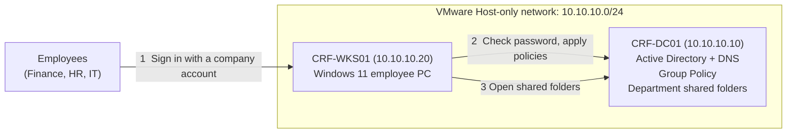
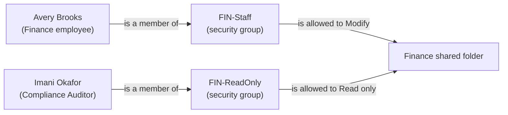

# Cobalt Ridge Financial: Active Directory Fundamentals Lab

A beginner-friendly, scenario-based Active Directory lab for a fictional small bank, **Cobalt Ridge Financial**. I built it on **VMware Workstation** with just two virtual machines: a Windows Server **domain controller** and a Windows 11 **employee computer**.

The goal is simple: take a company that has no central user management, and set up the everyday things a junior IT administrator is trusted with. That means organizing people, giving them the right access to shared folders, setting basic security rules, and handling new hires, role changes and leavers.

**What I was asked to do (my manager's four requests):**

| # | Request from my IT manager | What it means in plain English | Done in |
| - | -------------------------- | ------------------------------ | ------- |
| 1 | "Give every employee one sign-in that works on every company PC" | Build a domain, create users, join a PC to it | Sections 2, 4, 6 |
| 2 | "Make sure people only open the folders for their own department" | Shared folders with permissions based on groups | Sections 4, 5 |
| 3 | "Set basic security rules for passwords and one restriction for HR PCs" | Group Policy | Section 7 |
| 4 | "Handle new hires, transfers and leavers the same way every time" | The account lifecycle (Joiner, Mover, Leaver) | Section 8 |

**Skills practised:** Windows Server, Active Directory Domain Services (AD DS), DNS basics, Organizational Units, users and security groups, NTFS and share permissions, Group Policy, PowerShell basics, Event Viewer.

---

## Architecture

*Two VMs on a private VMware network. The Windows 11 PC asks the domain controller to check every sign-in, applies the company's Group Policies, and opens department folders that the domain controller shares.*

### How folder access works (the one idea to remember)

*I never give a person access to a folder directly. I put people in groups and give the group access. When someone changes jobs, I change their groups and the access follows.*

<a href="https://github.com/Gbemiga97/Domain-Joined-Endpoint-to-Domain-Controller/blob/main/Lab.md">Lab</a>
---
